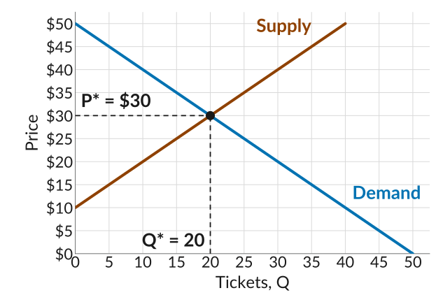
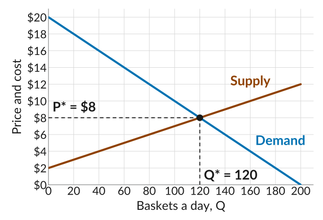
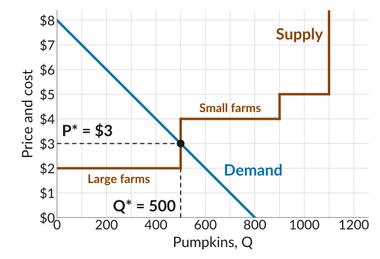

::: {.practice-links}
[Lecture 15 slides](../slides/lecture15.html) · [Lecture 16 slides](../slides/lecture16.html) · [Worksheet 15 (PDF)](../worksheets/worksheet15.pdf) · [Module IV: Markets with Many Buyers and Sellers](../content/markets-with-many-buyers-and-sellers.qmd)
:::

Work through each problem on paper before you open its **Solution**.

## 1. Used textbooks

*(Adapted from CORE 8.2 and 8.3)* At a used-book sale run by the student union, students starting an introductory economics course buy used copies of the textbook from students who have finished it. All the copies are identical. Six buyers are willing to pay \$40, \$35, \$30, \$25, \$20, and \$15. Six sellers are willing to accept \$10, \$15, \$20, \$25, \$30, and \$35. To get the sale started, the union posts a suggested price.

**(a)** The union suggests a price of \$30. How many students want to buy, and how many want to sell, at the suggested price? What happens next?

Solution

At \$30, the buyers willing to pay \$30 or more are the ones at \$40, \$35, and \$30: **3 buyers**. The sellers willing to accept \$30 or less are the ones at \$10, \$15, \$20, \$25, and \$30: **5 sellers**. That is an **excess supply of 2**: two sellers cannot find a buyer.

A seller who would part with their copy for \$20 is better off selling it for \$28 than taking it home, so the sellers left without a buyer offer their copies for less than \$30. Buyers go to the cheaper copies, and the **price comes down**.

**(b)** Suppose instead the union suggests a price of \$20. How many students want to buy, and how many want to sell, at the suggested price? What happens next?

Solution

At \$20, the buyers willing to pay \$20 or more are the ones at \$40, \$35, \$30, \$25, and \$20: **5 buyers**. The sellers willing to accept \$20 or less are the ones at \$10, \$15, and \$20: **3 sellers**. That is an **excess demand of 2**: two buyers cannot find a copy.

A buyer willing to pay \$35 is better off paying \$22 than going without, so the buyers left without a copy offer more than \$20. Sellers see they can ask more and still sell, and the **price goes up**.

## 2. The homecoming game

Students resell tickets to the homecoming game to each other. The quantity of tickets demanded is $Q^d = 50 - P$ and the quantity supplied is $Q^s = P - 10$, where $P$ is the price in dollars.

**(a)** Find the equilibrium price and quantity.

Solution

At the equilibrium, the quantity demanded equals the quantity supplied, so set $Q^d = Q^s$:
$$50 - P = P - 10$$
so $60 = 2P$ and $P^* =$ **\$30**. Then $Q^* = 50 - 30 =$ **20 tickets**. Supply gives the same: $30 - 10 = 20$.

**(b)** Plot the demand and supply curves, with the price on the vertical axis and the number of tickets on the horizontal axis. Mark the equilibrium price and quantity.

Solution

Since the price goes on the vertical axis, it helps to write each curve with $P$ on the left. Demand, $Q^d = 50 - P$, becomes $P = 50 - Q$. Supply, $Q^s = P - 10$, becomes $P = 10 + Q$.

Each curve is a straight line, so two points are enough to draw it. For demand, at $Q = 0$ the price is \$50, and at $Q = 50$ the price is \$0. For supply, at $Q = 0$ the price is \$10, and at $Q = 40$ the price is \$50. Plot each pair of points and draw a straight line through them. The lines cross at the equilibrium, 20 tickets and \$30.

{width="600" fig-alt="The ticket market: a demand line falling from 50 dollars at zero tickets to zero at 50 tickets, and a supply line rising from 10 dollars at zero tickets to 50 dollars at 40 tickets, on a grid marked every 5 tickets and every 5 dollars. They cross at 20 tickets and 30 dollars, marked with a dot and dashed guides labelled P star equals 30 dollars and Q star equals 20."}

If you are given the curves in this form, with $P$ on the left, you can also use them directly to find the equilibrium. Set the two prices equal: $50 - Q = 10 + Q$, so $40 = 2Q$ and $Q^* = 20$. Then $P^* = 50 - 20 = 30$, the same answer as in part (a).

**(c)** Why does the price settle at \$30? What happens if the price is above it, say \$40, or below it, say \$20?

Solution

At \$40, $Q^d = 50 - 40 = 10$ and $Q^s = 40 - 10 = 30$: an **excess supply of 20 tickets**. Sellers who cannot find a buyer cut their price. As the price falls, more students want to buy and fewer want to sell, so the excess supply shrinks. The price keeps falling until it is gone, at \$30.

At \$20, $Q^d = 50 - 20 = 30$ and $Q^s = 20 - 10 = 10$: an **excess demand of 20 tickets**. Buyers who cannot get a ticket offer more. As the price rises, fewer students want to buy and more want to sell, so the excess demand shrinks. The price keeps rising until it is gone, at \$30.

At \$30, the quantity demanded equals the quantity supplied, 20 tickets. No one is left out, so no one has a reason to change the price: \$30 is the **equilibrium price**.

## 3. Strawberries at the farmers market

*(Adapted from CORE Exercise E8.3)* Many stands at the Saturday farmers market sell the same baskets of strawberries. Demand is $P = 20 - Q/10$ and supply is $P = 2 + Q/20$, where $Q$ is baskets a day and $P$ is the price in dollars.

**(a)** Find the equilibrium price and quantity.

Solution

Set demand equal to supply:
$$20 - \frac{Q}{10} = 2 + \frac{Q}{20}$$
Collect terms: $18 = \frac{Q}{10} + \frac{Q}{20} = \frac{3Q}{20}$, so $Q^* = 18 \times \frac{20}{3} =$ **120 baskets**.

Then $P^* = 20 - 120/10 =$ **\$8**. Supply gives the same: $2 + 120/20 = 8$.

{width="600" fig-alt="The strawberry market: a demand line falling from 20 dollars at zero baskets to zero at 200 baskets, and a supply line rising from 2 dollars at zero baskets to 12 dollars at 200 baskets, with price and cost marked every 2 dollars and baskets every 20. They cross at 120 baskets and 8 dollars, marked with a dot and dashed guides labelled P star equals 8 dollars and Q star equals 120."}

**(b)** At a price of \$11, how many baskets are demanded and how many are supplied? What happens to the price?

Solution

Demand: $11 = 20 - Q/10$, so $Q/10 = 9$ and **90 baskets** are demanded.

Supply: $11 = 2 + Q/20$, so $Q/20 = 9$ and **180 baskets** are supplied.

That is an **excess supply of 90 baskets**. Stands with unsold strawberries have an incentive to lower their price, so the **price falls** toward \$8.

**(c)** At a price of \$5?

Solution

Demand: $5 = 20 - Q/10$, so $Q/10 = 15$ and **150 baskets** are demanded.

Supply: $5 = 2 + Q/20$, so $Q/20 = 3$ and **60 baskets** are supplied.

That is an **excess demand of 90 baskets**. Shoppers who go without are willing to pay more, so stands have an incentive to raise their price, and the **price rises** toward \$8.

## 4. Pumpkin farms

*(Adapted from CORE Question 8.5)* Fifteen farms sell pumpkins at a roadside market, and every farm takes the going price. Five large farms can each grow up to 100 pumpkins at a marginal cost of \$2. Ten small farms can each grow up to 40 pumpkins at a marginal cost of \$4, and up to 20 more at \$5.

**(a)** At a price of \$3, how many pumpkins does each kind of farm sell? What is the market supply?

Solution

A large farm sells every pumpkin whose marginal cost is below \$3: **100** each. A small farm's marginal cost of \$4 is above the price, so it sells **none**. Market supply is $5 \times 100 + 10 \times 0 =$ **500 pumpkins**.

**(b)** What is the market supply at \$4.50? At \$6?

Solution

At \$4.50, large farms still sell 100 each, and small farms now sell 40 each (their extra pumpkins cost \$5): $5 \times 100 + 10 \times 40 =$ **900**.

At \$6, large farms sell 100 each and small farms all 60: $5 \times 100 + 10 \times 60 =$ **1,100**.

**(c)** Demand is $P = 8 - Q/100$. Find the equilibrium price and quantity. Which farms sell?

Solution

From part (a), market supply is 500 at every price between \$2 and \$4. Demand for 500 pumpkins needs a price of $P = 8 - 500/100 = 3$, which is in that range. So the market clears at **\$3 and 500 pumpkins**. Only the **large farms** sell, because the small farms' marginal cost of \$4 is above the price.

{width="600" fig-alt="The pumpkin market, price and cost on the vertical axis from 0 to 8 dollars in steps of 1, and pumpkins on the horizontal axis from 0 to 1,200 with gridlines every 100. Market supply is a staircase: flat at 2 dollars from 0 to 500 pumpkins, labelled large farms; up to 4 dollars and flat to 900, labelled small farms; up to 5 dollars and flat to 1,100, the small farms' extra pumpkins; then straight up. The demand line falls from 8 dollars at zero pumpkins to zero at 800. It crosses the supply staircase on the vertical step at 500 pumpkins, at 3 dollars, marked with a dot and dashed guides labelled P star equals 3 dollars and Q star equals 500."}

**(d)** At the equilibrium price of \$3, why can't any one farm make more profit by charging a higher or a lower price?

Solution

A large farm that charges more than \$3 sells **nothing**: shoppers buy identical pumpkins from the other farms at \$3. A large farm that charges less, say \$2.50, sells **no more** than it would at \$3, since at \$3 it can already sell all 100 of its pumpkins. It just earns 50 cents less on each one, $100 \times 0.50 = 50$ dollars less in all.

A small farm cannot do better either. Above \$3 it sells nothing, and at \$3 or less every pumpkin costs it \$4 to grow, so it would lose money on each one it sold.

So no farm can gain by charging anything other than the going price: each farm is a **price-taker**, and no one wants to change what they are doing. That is why the competitive equilibrium is a Nash equilibrium.

## 5. Multiple choice

::: {.mcq answer="b"}

**Q1.** Why does the supply curve for used textbooks slope upward?

  a. Sellers always want to earn as much as possible.
  b. At a higher price, sellers with a higher willingness to accept are also willing to sell, so more copies are offered.
  c. Buyers are willing to pay less when more copies are offered.
  d. At a higher price, sellers with a lower willingness to accept are no longer willing to sell.

Solution

The supply curve lines up the sellers by willingness to accept, lowest first. At a higher price, everyone who was already willing to sell still is, and sellers with a higher willingness to accept join them. A seller willing to sell for \$15 is still happy to sell for \$30, so no one drops out as the price rises. **(b)** is correct.

:::

::: {.mcq answer="c"}

**Q2.** Why does the price in a market with many buyers and sellers settle where the quantity demanded equals the quantity supplied?

  a. Sellers agree with each other to charge the price that gives them the most total profit.
  b. Buyers and sellers split the difference between the highest willingness to pay and the lowest willingness to accept.
  c. At any other price, some buyers or sellers cannot trade, and they can do better by offering or asking a different price.
  d. At that price, every buyer pays exactly their willingness to pay.

Solution

Above that price there is an excess supply: some sellers are stuck with goods they would happily sell for a little less, so they cut their price. Below it there is an excess demand: some buyers go without goods they would happily pay a little more for, so they offer more. Only where the quantity demanded equals the quantity supplied is no one stuck, so no one has a reason to change the price. Sellers do not agree on a price, no one splits any difference, and most buyers pay less than their willingness to pay. **(c)** is correct.

:::

::: {.mcq answer="a"}

**Q3.** In the market for used bikes on campus, demand is $P = 200 - Q$ and supply is $P = 50 + Q/2$. What are the equilibrium price and quantity?

  a. \$100 and 100 bikes
  b. \$150 and 100 bikes
  c. \$50 and 75 bikes
  d. \$125 and 75 bikes

Solution

Set demand equal to supply: $200 - Q = 50 + Q/2$, so $150 = 3Q/2$ and $Q = 100$. Then plug $Q = 100$ back into either curve for the price: $P = 200 - 100 = 100$, and supply gives $50 + 100/2 = 100$ too. **(a)** is correct.

:::

::: {.mcq answer="d"}

**Q4.** A seller is a price-taker when:

  a. They choose the price on their demand curve that maximizes their profit.
  b. They charge the same price as their rivals because they have agreed to.
  c. Their marginal cost is lower than their rivals'.
  d. They cannot gain by selling at any price other than the going market price.

Solution

A price-taker cannot move the price but can sell as much as they like at it: asking more loses every customer to other sellers, and asking less gives money away. Choosing a price on a downward-sloping demand curve is what a price setter does, like Cheerios. Sellers who agree on a price are a cartel, not price-takers. A low marginal cost does not give a seller any power over the price. **(d)** is correct.

:::

::: {.mcq answer="b"}

**Q5.** Why is a competitive equilibrium a Nash equilibrium?

  a. At the market price, sellers make the most profit they possibly can.
  b. Given that everyone else trades at the market price, no buyer or seller can do better by trading at a different price.
  c. Every buyer and seller gets the largest gain they could possibly get.
  d. Buyers and sellers agree together on the price that is best for the market.

Solution

A Nash equilibrium is an outcome where no one can do better by changing their own action, given what everyone else is doing. At the market price, a seller who asks more sells nothing and a buyer who offers less buys nothing, so trading at the going price is everyone's best response. Sellers would earn more at a higher price and buyers would gain more at a lower one, so the market price is not the best possible price for either side, and no one agrees on anything: each person acts alone. **(b)** is correct.

:::

::: {.mcq answer="c"}

**Q6.** *(Adapted from CORE Question 8.3)* In problem 3, the demand and supply curves for strawberries cross at 120 baskets and \$8. Which statement is correct?

  a. At \$11, there is an excess demand for strawberries.
  b. At \$8, a stand would benefit from raising its price to \$9.
  c. At \$14, there is an excess supply of 180 baskets.
  d. The number of baskets sold is 200, the most anyone would buy at a price of zero.

Solution

At \$14, demand gives $14 = 20 - Q/10$, so 60 baskets, and supply gives $14 = 2 + Q/20$, so 240 baskets: an excess supply of $240 - 60 = 180$. At \$11 the price is also above \$8, so there is an excess supply there too, not an excess demand. A stand asking \$9 would sell nothing, because shoppers can buy at \$8 from the other stands. Shoppers willing to pay less than \$8 do not buy, so only 120 baskets are sold. **(c)** is correct.

:::

::: {.mcq answer="c"}

**Q7.** Which seller is most likely to be a price-taker?

  a. One of twenty restaurants in a college town, each with its own menu.
  b. One of three wireless carriers selling similar phone plans.
  c. One of thousands of farms selling the same grade of wheat into a grain market.
  d. A popular coffee shop with a loyal group of regulars.

Solution

A seller is a price-taker when there are many sellers and they all sell the same good, so buyers can switch freely. The restaurants are many, but each menu is different, so each can charge a bit more and keep some diners. Three carriers are too few: each one's price affects the others. Loyal regulars mean the coffee shop can raise its price and keep many of its customers. Only the wheat farm has both many rivals and an identical product. **(c)** is correct.

:::

::: {.mcq answer="d"}

**Q8.** Why is one bakery's demand curve flat at the going price of bread?

  a. Its marginal cost is the same for every loaf.
  b. The town's demand for bread does not change with the price.
  c. Customers buy the same number of loaves at any price.
  d. Its loaves are the same as other bakeries', so if it charged more, customers would buy from another bakery.

Solution

With identical loaves and customers who can switch easily, a bakery that charges more than the going price sells nothing, while at the going price it can sell as many loaves as it likes. That is a flat line at the going price. The bakery's marginal cost is about its costs, not its customers. The town's demand for bread still slopes down: it is one bakery's demand that is flat. And customers buying the same amount at any price would be a vertical demand curve, not a flat one. **(d)** is correct.

:::

::: {.mcq answer="c,d"}

**Q9.** *(Adapted from CORE Question 8.4)* Lena runs one of many identical lemonade stands. Her marginal cost is \$1 a cup up to 60 cups and \$4 a cup up to 90, and the going price is \$3. Select all the statements that are correct.

  a. Lena's supply curve is horizontal.
  b. If the going price falls to \$2, she sells fewer cups.
  c. If the going price rises to \$4, any number of cups from 60 to 90 gives her the same profit.
  d. Her marginal cost curve is her supply curve.

Solution

Her demand curve is horizontal; her supply curve is the marginal cost step. At \$2 she still sells 60 cups, since each one still adds \$1. At \$4, the cups beyond 60 cost exactly \$4, so they add nothing to profit and she does equally well selling them or not. **(c) and (d)** are correct.

:::

::: {.mcq answer="b"}

**Q10.** A town has ten identical bakeries. Each can bake up to 50 loaves a day at a marginal cost of \$3, and up to 30 more at \$6. What is the market supply at a price of \$5?

  a. 300 loaves
  b. 500 loaves
  c. 800 loaves
  d. 0 loaves

Solution

At \$5, each bakery bakes the 50 loaves that cost \$3, but not the extra loaves that cost \$6. Market supply is $10 \times 50 = 500$. **(b)** is correct.

:::

::: {.mcq answer="a,c"}

**Q11.** In a city with many bakeries, the height of the market supply curve at 7,000 loaves is \$2.74. Select all the statements that are correct.

  a. The marginal cost of the 7,000th loaf is \$2.74.
  b. The average cost of all 7,000 loaves is \$2.74.
  c. At a price of \$2.74, the bakeries want to sell 7,000 loaves.
  d. Each bakery makes a profit of \$2.74 a loaf.

Solution

The market supply curve can be read two ways. Read up from a quantity, and its height is the marginal cost of that loaf: the 7,000th loaf costs \$2.74 to make. Read across from a price, and it gives the number of loaves the bakeries want to sell: at \$2.74, every loaf that costs \$2.74 or less to make is worth baking, which is 7,000 loaves. It says nothing about average cost or profit. **(a) and (c)** are correct.

:::
