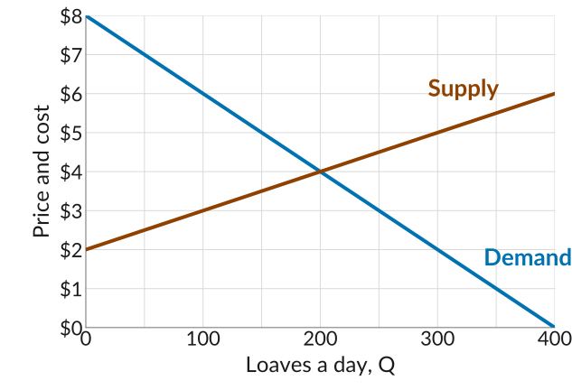
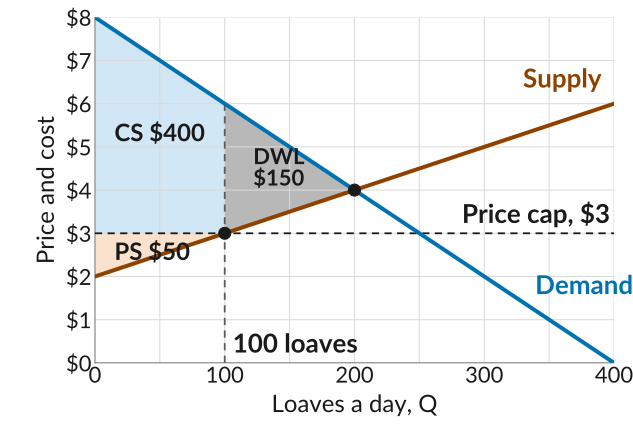
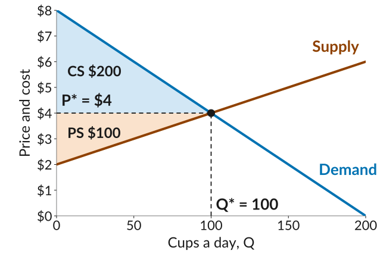
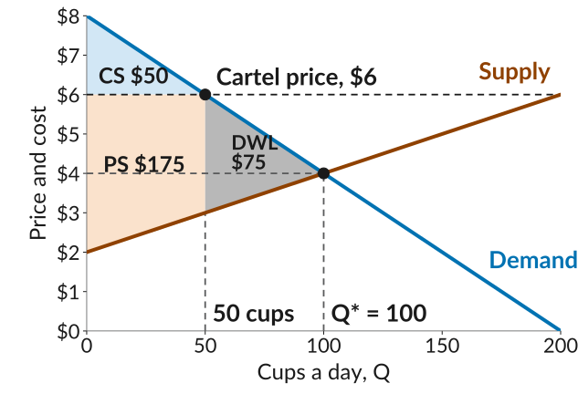

::: {.practice-links}
[Lecture 17 slides](../slides/lecture17.html) · [Worksheet 17 (PDF)](../worksheets/worksheet17.pdf) · [Module IV: Markets with Many Buyers and Sellers](../content/markets-with-many-buyers-and-sellers.qmd)
:::

Work through each problem on paper before you open its **Solution**.

## 1. A price cap on bread

The bakeries in town all sell the same loaf. The graph shows the demand and supply curves for bread.

{width="480" fig-alt="A plotting grid, price and cost on the vertical axis from 0 to 8 dollars with gridlines every dollar, and loaves a day on the horizontal axis from 0 to 400 with gridlines every 50 loaves and labels every 100. The demand curve falls in a straight line from 8 dollars at zero loaves to zero at 400 loaves. The supply curve rises in a straight line from 2 dollars at zero loaves to 6 dollars at 400 loaves. They cross at 200 loaves and 4 dollars."}

**(a)** What are the equilibrium price and quantity? Compute the consumer surplus and the producer surplus at the equilibrium.

Solution

{width="480" fig-alt="The bread market with dashed guides to the equilibrium at 200 loaves and 4 dollars. The triangle between the demand line and the price line, from zero to 200 loaves, is shaded light blue and labelled CS, 400 dollars; the triangle between the price line and the supply line is shaded light orange and labelled PS, 200 dollars."}

The equilibrium is the point where the quantity demanded equals the quantity supplied, which is where the two curves cross: a price of **\$4** and a quantity of **200 loaves**.

Any buyer's surplus is their willingness to pay, read off the demand curve, minus the price. For all the buyers together, it is the sum of those gaps, which is the area between the demand curve and the price line, shaded blue above. Using the area of a triangle:
$$\text{CS} = \tfrac{1}{2} \times \text{base} \times \text{height} = \tfrac{1}{2} \times 200 \times (8 - 4) = \mathbf{400}$$

Any loaf's surplus for its bakery is the price minus its marginal cost, read off the supply curve. For all the loaves together, it is the area between the price line and the supply curve, shaded orange above. Using the area of a triangle:
$$\text{PS} = \tfrac{1}{2} \times 200 \times (4 - 2) = \mathbf{200}$$

**(b)** The city council decides bread is too expensive and caps its price at \$3 a loaf. At \$3, how many loaves do the bakeries bake? How many do buyers want? How many loaves sell? Mark the price and the quantity sold on the graph.

Solution

Read across from \$3 on the price axis. The supply curve is at 100 loaves, so the bakeries bake **100**: every loaf that costs less than \$3 to bake. The demand curve is at 250 loaves, so buyers want **250**. Only the 100 loaves that get baked can sell, so **100 loaves sell**, at the point on the supply curve at \$3, and 150 buyers who want a loaf at \$3 go without.

**(c)** Shade the consumer surplus, the producer surplus, and the deadweight loss under the cap, and compute each.

Solution

{width="480" fig-alt="The bread market, loaves a day from 0 to 400 and price and cost from 0 to 8 dollars, with a dashed line at 3 dollars labelled Price cap, 3 dollars. A dot marks where it meets the supply line at 100 loaves, labelled 100 loaves. The area between the demand line and the 3 dollar line up to 100 loaves is shaded light blue and labelled CS, 400 dollars; the triangle between the 3 dollar line and the supply line up to 100 loaves is shaded light orange and labelled PS, 50 dollars; the triangle between the demand and supply lines from 100 to 200 loaves is shaded grey and labelled DWL, 150 dollars. A dot marks the equilibrium at 200 loaves and 4 dollars."}

Consumer surplus is the blue area, the gain to the 100 buyers who get a loaf. We can find it by adding the rectangle, with base 100 and height $6 - 3$, to the triangle on top of it, with base 100 and height $8 - 6$:
$$\text{CS} = 3 \times 100 + \tfrac{1}{2} \times 100 \times (8 - 6) = 300 + 100 = \mathbf{400}$$
Producer surplus is the orange area, the bakeries' gain on the 100 loaves sold: a triangle with base 100 and height $3 - 2$:
$$\text{PS} = \tfrac{1}{2} \times 100 \times (3 - 2) = \mathbf{50}$$
The deadweight loss is the grey triangle: the surplus from the trades between 100 and 200 loaves that no longer happen, even though each of those buyers values a loaf above what it would cost to bake. Its base is 100 and its height is the gap between the curves at 100 loaves, $6 - 3$:
$$\text{DWL} = \tfrac{1}{2} \times 100 \times (6 - 3) = \mathbf{150}$$
Check: total surplus falls from $400 + 200 = 600$ to $400 + 50 = 450$, a loss of 150.

**(d)** Compared with the equilibrium, who gains from the cap and who loses? By how much?

Solution

Producer surplus falls from \$200 to \$50, so the **bakeries lose \$150**. Consumer surplus is \$400 under the cap and \$400 at the equilibrium, so **buyers as a group come out even**: the 100 who still get a loaf pay \$1 less each and gain \$100 between them, while the 100 buyers with a WTP between \$4 and \$6 who no longer get one lose the surplus they had, $\tfrac{1}{2} \times 100 \times 2 = 100$.

Adding up everyone's gains and losses, $0 - 150 = -150$, gives the change in total surplus, which is the deadweight loss from part (c).

**(e)** Is the outcome under the cap Pareto efficient? Explain in one sentence.

Solution

**No.** A buyer who would pay \$5 for a loaf and a bakery that could bake one for \$3.50 would both be better off trading at any price in between, and nobody else would be worse off, so a Pareto improvement is still possible.

## 2. Hot cider at the fall festival

Many stands at the fall festival sell the same cup of hot cider. Demand is $P = 8 - Q/25$ and supply is $P = 2 + Q/50$, where $Q$ is cups a day and $P$ is the price in dollars.

**(a)** Find the equilibrium price and quantity.

Solution

Set demand equal to supply:
$$8 - \frac{Q}{25} = 2 + \frac{Q}{50}$$
Collect terms: $6 = \frac{Q}{25} + \frac{Q}{50} = \frac{3Q}{50}$, so $Q^* =$ **100 cups**. Then $P^* = 8 - 100/25 =$ **\$4**. Supply gives the same: $2 + 100/50 = 4$.

**(b)** Draw the demand and supply curves, shade the consumer surplus and the producer surplus at the equilibrium, and compute each. What is the total surplus?

Solution

Each curve is a straight line, so two points are enough to draw it. Demand meets the price axis at \$8 (at $Q = 0$, $P = 8 - 0/25 = 8$) and passes through the equilibrium at 100 cups and \$4; supply meets the price axis at \$2 (at $Q = 0$, $P = 2 + 0/50 = 2$) and passes through the same point. Draw both, mark the equilibrium, and shade the triangle above the price line and the one below it.

{width="480" fig-alt="The cider market, cups a day from 0 to 200 and price and cost from 0 to 8 dollars. The demand line falls from 8 dollars at zero cups and the supply line rises from 2 dollars; they cross at 100 cups and 4 dollars, marked with a dot and dashed guides labelled P star equals 4 dollars and Q star equals 100. The triangle between the demand line and the price line is shaded light blue and labelled CS, 200 dollars; the triangle between the price line and the supply line is shaded light orange and labelled PS, 100 dollars."}

Consumer surplus is the blue triangle, with base 100 (the cups sold) and height from the price up to the demand intercept, $8 - 4$:
$$\text{CS} = \tfrac{1}{2} \times \text{base} \times \text{height} = \tfrac{1}{2} \times 100 \times (8 - 4) = \mathbf{200}$$

Producer surplus is the orange triangle, with the same base of 100 and height from the supply intercept up to the price, $4 - 2$:
$$\text{PS} = \tfrac{1}{2} \times 100 \times (4 - 2) = \mathbf{100}$$

Total surplus is $200 + 100 =$ **\$300**.

**(c)** The stands form a cartel: they agree to charge \$6 a cup and to make only as many cups as buyers want at that price. How many cups sell? Compute the consumer surplus, the producer surplus, and the deadweight loss.

Solution

At \$6, demand gives $6 = 8 - Q/25$, so **50 cups** sell. It helps to draw the two curves, mark the cartel price and the 50 cups, and shade each area before computing it:

{width="480" fig-alt="The cider market, cups a day from 0 to 200 and price and cost from 0 to 8 dollars, with a dashed line at 6 dollars labelled Cartel price, 6 dollars. A dot marks where it meets the demand line at 50 cups, labelled 50 cups. The triangle between the demand line and the 6 dollar line up to 50 cups is shaded light blue and labelled CS, 50 dollars; the area between the 6 dollar line and the supply line up to 50 cups is shaded light orange and labelled PS, 175 dollars; the triangle between the demand and supply lines from 50 to 100 cups is shaded grey and labelled DWL, 75 dollars. A dot and dashed guides mark the equilibrium at Q star equals 100 and 4 dollars."}

Consumer surplus is the blue triangle, with base 50 and height from the cartel price up to the demand intercept, $8 - 6$:
$$\text{CS} = \tfrac{1}{2} \times 50 \times (8 - 6) = \mathbf{50}$$
Producer surplus is the orange area. The 50th cup costs $2 + 50/50 = 3$ to make, so the area is a rectangle of height $6 - 3$ plus a triangle of height $3 - 2$, both with base 50:
$$\text{PS} = (6 - 3) \times 50 + \tfrac{1}{2} \times 50 \times (3 - 2) = 150 + 25 = \mathbf{175}$$
The deadweight loss is the grey triangle, the surplus from the cups between 50 and 100 that are no longer made even though buyers value them above their cost. Its base is 50 and its height is the gap between the curves at 50 cups, $6 - 3$:
$$\text{DWL} = \tfrac{1}{2} \times 50 \times (6 - 3) = \mathbf{75}$$
Check: total surplus falls from \$300 to $50 + 175 = 225$, a loss of 75.

**(d)** Who gains from the cartel and who loses? By how much?

Solution

The **stands gain**: producer surplus rises from \$100 to \$175, up **\$75**. **Buyers lose**: consumer surplus falls from \$200 to \$50, down **\$150**. Adding up everyone's gains and losses, $75 - 150 = -75$, gives the change in total surplus, which is the deadweight loss from part (c): buyers lose twice what the stands gain, and the difference is the surplus from the 50 cups that are no longer made.

## 3. Multiple choice

::: {.mcq answer="b"}

**Q1.** In a competitive market the price is \$5. A buyer with a willingness to pay of \$9 buys a unit, and a seller whose marginal cost is \$3 sells one. How much surplus does each of them get?

  a. The buyer \$9 and the seller \$3.
  b. The buyer \$4 and the seller \$2.
  c. The buyer \$2 and the seller \$4.
  d. The buyer \$5 and the seller \$5.

Solution

A buyer's surplus is willingness to pay minus the price, $9 - 5 = 4$. A seller's surplus on a unit is the price minus its marginal cost, $5 - 3 = 2$. Neither depends on who trades with whom, since everyone trades at \$5. **(b)** is correct.

:::

::: {.mcq answer="b"}

**Q2.** Demand for parking spots at a Saturday market is $P = 20 - Q/5$. The going price is \$10. What is the consumer surplus?

  a. \$500
  b. \$250
  c. \$125
  d. \$1,000

Solution

At \$10, demand gives $10 = 20 - Q/5$, so 50 spots are rented. The first buyer would pay \$20, so consumer surplus is the triangle $\tfrac{1}{2} \times 50 \times (20 - 10) = 250$. **(b)** is correct.

:::

::: {.mcq answer="a"}

**Q3.** Beautiful Cars, the only seller of its model, sells 20 cars a day. The town's bread market, with many bakeries, clears at 200 loaves a day. Which statement is correct?

  a. Beautiful Cars' price is above the marginal cost of its 20th car, while the bread price equals the marginal cost of the 200th loaf.
  b. Beautiful Cars' price equals the marginal cost of its 20th car, while the bread price is above the marginal cost of the 200th loaf.
  c. In both markets the price equals the marginal cost of the last unit sold.
  d. In both markets the price is above the marginal cost of the last unit sold.

Solution

A price setter chooses the quantity where marginal revenue equals marginal cost and then charges the most buyers will pay for that quantity. That price is above marginal cost, because marginal revenue is below the price. Buyers with a willingness to pay between the two go without a car, which is the deadweight loss. A price-taker produces every unit whose marginal cost is below the going price, so the last loaf's marginal cost equals the price and no trade worth making is left. **(a)** is correct.

:::

::: {.mcq answer="b,d"}

**Q4.** *(Adapted from CORE Question 8.6)* A competitive market for bread clears at 5,000 loaves and \$2. The mayor decrees that bakeries must sell bread at \$1.50. Select all the statements that are correct.

  a. Consumer surplus and producer surplus both increase.
  b. Producer surplus is lower than at the market equilibrium.
  c. There is no deadweight loss, because the price is lower.
  d. Total surplus is lower than at the market equilibrium.

Solution

At \$1.50, the bakeries whose loaves cost between \$1.50 and \$2 to bake stop selling, so fewer loaves are baked and producer surplus falls. The loaves no longer baked were worth more to buyers than they cost, so their surplus is lost: a deadweight loss, and a lower total surplus. Consumer surplus may rise or fall, but it cannot rise together with producer surplus when total surplus falls. **(b) and (d)** are correct.

:::

::: {.mcq answer="c"}

**Q5.** A competitive market clears at \$4. In which case is there a deadweight loss?

  a. When the price is held above \$4, but not when it is held below.
  b. When the price is held below \$4, but not when it is held above.
  c. When the price is held either above or below \$4.
  d. In neither case, as long as every unit sells at a single price.

Solution

At a price above \$4, buyers want fewer units than at the equilibrium, so fewer trade. At a price below \$4, sellers offer fewer units, so again fewer trade. Either way, the units between the quantity traded and the equilibrium quantity were worth more to buyers than they cost to make, and they no longer get made: the deadweight loss is the triangle between the two curves over those units. It is only at the equilibrium price that every unit worth making gets made. **(c)** is correct.

:::

::: {.mcq answer="b,d"}

**Q6.** *(Adapted from CORE Question 8.7)* Select all the statements about a competitive equilibrium allocation that are correct.

  a. It is the best possible allocation for everyone in the market.
  b. No one's surplus can be raised without lowering someone else's.
  c. It is always Pareto efficient, whatever else is going on.
  d. The total surplus from trade in the market is maximized.

Solution

The competitive equilibrium maximizes total surplus, so no buyer's or seller's surplus can rise without another's falling. That does not make it best for everyone: buyers would prefer a lower price and sellers a higher one, and the split may be unfair. And it is Pareto efficient only if no one outside the market is affected; with external effects, such as pollution from production, it may not be. **(b) and (d)** are correct.

:::

::: {.mcq answer="d"}

**Q7.** Which of the following is *not* one of the conditions under which a competitive equilibrium is Pareto efficient?

  a. Trade in the market has no external effects.
  b. Each trade is covered by a complete contract.
  c. Many buyers and sellers trade identical goods.
  d. The price is set by a government regulator.

Solution

The result needs many price-taking buyers and sellers of identical goods, a market at its equilibrium, no external effects, and complete contracts. A regulated price is not one of them; a price held away from the equilibrium creates a deadweight loss. **(d)** is correct.

:::

::: {.mcq answer="a"}

**Q8.** In two markets with the same demand curve and the same equilibrium price and quantity, the supply curve is steep in one and flat in the other. Which statement is correct?

  a. Sellers get a larger share of the surplus where supply is steep.
  b. Sellers get a larger share of the surplus where supply is flat.
  c. Sellers get the same share of the surplus in both markets.
  d. Buyers get a larger surplus where the supply curve is steep.

Solution

Producer surplus is the area between the price and the supply curve. A steep (inelastic) supply curve means many units cost far less than the price to produce, so that area is large; a flat (elastic) one hugs the price, so the area is small. Consumer surplus is the same in both markets, since demand and the price are the same. **(a)** is correct.

:::
