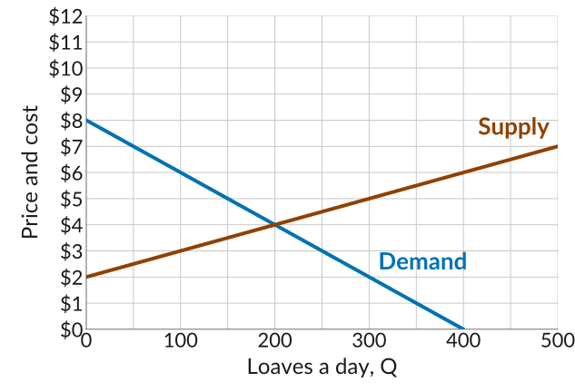
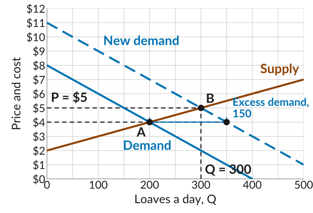
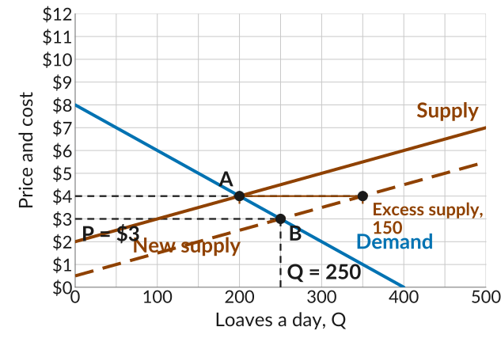

::: {.practice-links}
[Lecture 18 slides](../slides/lecture18.html) · [Worksheet 18 (PDF)](../worksheets/worksheet18.pdf) · [Module IV: Markets with Many Buyers and Sellers](../content/markets-with-many-buyers-and-sellers.qmd)
:::

Work through each problem on paper before you open its **Solution**.

## 1. The bread market

Many bakeries in town sell the same loaf. The graph shows the demand and supply curves for bread. In equilibrium, 200 loaves a day sell at \$4.

{width="480" fig-alt="A plotting grid, price and cost on the vertical axis from 0 to 12 dollars with gridlines every dollar, and loaves a day on the horizontal axis from 0 to 500 with gridlines every 50 loaves and labels every 100. The demand curve falls in a straight line from 8 dollars at zero loaves to zero at 400 loaves. The supply curve rises in a straight line from 2 dollars at zero loaves to 7 dollars at 500 loaves. They cross at 200 loaves and 4 dollars."}

**(a)** Sourdough goes viral, and at every price buyers now want 150 more loaves than before. Draw the new demand curve. Which way did it shift?

Solution

At every price, buyers want 150 more loaves, so every point on the demand curve moves 150 loaves to the right: the new demand curve is parallel to the old one and 150 loaves to its right. Demand has increased, a shift to the **right**. To draw it, take two points on the old curve and move each 150 loaves right: 0 loaves at \$8 becomes 150 at \$8, and 200 at \$4 becomes 350 at \$4. The straight line through those two points is the new demand curve.

**(b)** If the price stayed at \$4, how many loaves would buyers want and how many would the bakeries bake? Is there excess demand or excess supply, and how much?

Solution

Read across from \$4. The old demand curve is at 200 loaves, so the new one, 150 to its right, is at 350: buyers want **350 loaves**. The supply curve has not moved, so the bakeries still bake **200**. Buyers want 150 more loaves than get baked: an **excess demand of 150**.

**(c)** Find the new equilibrium price and quantity. Did the supply curve shift?

Solution

{width="480" fig-alt="The bread market, loaves a day from 0 to 500 and price and cost from 0 to 12 dollars, with gridlines every 50 loaves and every dollar. The demand line falls from 8 dollars at zero loaves to zero at 400, and the supply line rises from 2 dollars at zero loaves to 7 dollars at 500. A dashed line labelled New demand runs parallel to the demand line and 150 loaves to its right, from 11 dollars at zero loaves to 1 dollar at 500. Point A marks the old equilibrium at 200 loaves and 4 dollars. A dashed line at 4 dollars runs from A out to the new demand line at 350 loaves, with a blue bracket between them labelled Excess demand, 150. Point B marks where the new demand line crosses the supply line, at 300 loaves and 5 dollars, with dashed guides labelled P equals 5 dollars and Q equals 300."}

The new equilibrium is where the new demand curve crosses the supply curve, at B: **300 loaves at \$5**. How does the market get there? At \$4 bakeries sell out every day and turn customers away. A bakery that sees this realises some customers would pay more, so it raises its price and bakes more, since loaves now sell above marginal cost. Others do the same, and the price keeps rising until the market clears at \$5.

The supply curve **did not shift**: no bakery's marginal cost changed. The bakeries bake 100 more loaves because the price rose from \$4 to \$5, a movement *along* the supply curve from A to B.

**(d)** Go back to the original demand curve. A new oven cuts every bakery's marginal cost by \$1.50 on every loaf. Draw the new supply curve. At \$4, how many loaves are baked and how many are wanted? Is there excess demand or excess supply, and how much?

Solution

The supply curve is the marginal cost curve, so when every loaf costs \$1.50 less to bake, the curve shifts **down by \$1.50**. The supply curve rises \$1 for every 100 loaves, so moving it down \$1.50 is the same as moving it 150 loaves to the right: at every price, the bakeries bake 150 more loaves. Supply has increased.

Read across from \$4. The new supply curve is at $200 + 150 = 350$ loaves, so the bakeries bake **350**. The demand curve has not moved, so buyers still want **200**. That is an **excess supply of 150**: loaves baked that nobody buys at \$4.

**(e)** Find the new equilibrium price and quantity. Did the demand curve shift?

Solution

{width="480" fig-alt="The bread market, loaves a day from 0 to 500 and price and cost from 0 to 12 dollars, with gridlines every 50 loaves and every dollar. The demand line falls from 8 dollars at zero loaves to zero at 400, and the supply line rises from 2 dollars at zero loaves to 7 dollars at 500. A dashed line labelled New supply runs parallel to the supply line and 1 dollar 50 below it, from 50 cents at zero loaves to 5 dollars 50 at 500. Point A marks the old equilibrium at 200 loaves and 4 dollars. A dashed line at 4 dollars runs from A out to the new supply line at 350 loaves, with an orange bracket below it labelled Excess supply, 150. Point B marks where the demand line crosses the new supply line, at 250 loaves and 3 dollars, with dashed guides labelled P equals 3 dollars and Q equals 250."}

The new equilibrium is where the demand curve crosses the new supply curve, at B: **250 loaves at \$3**. The demand curve **did not shift**: nobody's willingness to pay changed. Buyers take 50 more loaves because the price fell from \$4 to \$3, a movement *along* the demand curve from A to B.

## 2. Which curve shifts?

For each market, say which curve shifts and which way, and whether the equilibrium price and quantity rise or fall.

**(a)** A frost ruins half the orange crop. The market for oranges.

Solution

The **supply curve shifts left**: at every price, growers have fewer oranges to sell. At the old price there is excess demand, so the **price rises** and the **quantity falls**.

**(b)** A study finds that walnuts are good for the heart. The market for walnuts.

Solution

The **demand curve shifts right**: at every price, more people want walnuts. At the old price there is excess demand, so the **price rises** and the **quantity rises**, with growers moving up along the supply curve.

**(c)** A cheaper battery comes on the market. The market for electric scooters.

Solution

The **supply curve shifts down**, or the same thing, right: every scooter costs less to make, so makers offer more at every price. At the old price there is excess supply, so the **price falls** and the **quantity rises**.

**(d)** A new app makes it easy for many more people to rent out a spare room. The market for short-term room rentals.

Solution

The **supply curve shifts right**: at every nightly price, many more rooms are on offer. At the old price there is excess supply, so the **price falls** and the **quantity rented rises**.

**(e)** Streaming subscriptions get cheaper. The market for movie theater tickets.

Solution

The **demand curve shifts left**: streaming is a substitute for a night at the theater, so at every ticket price fewer people want to go. At the old price there is excess supply, so the **price falls** and the **quantity falls**.

## 3. Multiple choice

::: {.mcq answer="b"}

**Q1.** A heat wave makes more people want lemonade at every price. In the competitive market for lemonade, which statement is correct?

  a. Demand shifts right, and so does supply, since sellers now sell more units.
  b. Demand shifts right, and quantity supplied rises along the supply curve.
  c. Demand shifts right, and quantity supplied stays fixed at the old level.
  d. Quantity demanded rises along the demand curve, and supply shifts right.

Solution

More lemonade wanted at every price is a shift of the demand curve. Nothing changed on the sellers' side, so the supply curve stays where it is; the higher price moves sellers up along it, and that is why the quantity supplied rises. **(b)** is correct.

:::

::: {.mcq answer="b,c"}

**Q2.** *(Adapted from CORE Question 8.8)* In problem 1, demand for bread rose and the market moved from A, 200 loaves at \$4, to B, 300 loaves at \$5. Select all the statements that are correct.

  a. Right after the shift, bakeries sell 350 loaves a day at the old price of \$4.
  b. Rent-seeking by buyers and sellers drives the move to the new equilibrium.
  c. While the market adjusts, some buyers may pay more for a loaf than others.
  d. The new equilibrium price could end up anywhere between \$4 and \$5.

Solution

At \$4 the bakeries will not bake beyond 200 loaves, because the extra loaves would cost more than \$4 to bake, so sales do not jump to 350. Prices and quantities change because buyers and sellers seek rents: a bakery that sells out raises its price, and until the market clears different buyers may pay different prices. The adjustment ends only where the new demand curve meets supply, at \$5. **(b) and (c)** are correct.

:::

::: {.mcq answer="a"}

**Q3.** A cheaper ingredient lowers the marginal cost of every taco at the farmers market, where many stands sell the same taco. In the new equilibrium:

  a. The price falls and the quantity rises.
  b. The price rises and the quantity rises.
  c. The price falls and the quantity falls.
  d. The price rises and the quantity falls.

Solution

Lower marginal cost shifts the supply curve down, which is also right: more tacos are offered at every price. At the old price there is excess supply, so stands with unsold tacos cut their prices, and the lower price draws buyers down along the demand curve to a larger quantity. **(a)** is correct.

:::

::: {.mcq answer="a"}

**Q4.** A shift in demand or supply is called an *exogenous shock*. What does exogenous mean here?

  a. The change comes from outside the model, which does not explain it.
  b. The change is so large that the market never settles at a new equilibrium.
  c. The change comes from the government, not from buyers or sellers.
  d. The change comes from a move in the price, which the model explains.

Solution

Exogenous means generated outside the model. We set up the model, find the equilibrium, and then ask how it changes when something shifts; the model shows the consequences of the shock, not its causes. A change in the price is the opposite case: the model works it out. **(a)** is correct.

:::

::: {.mcq answer="a"}

**Q5.** Two markets have the same demand curve and start at the same equilibrium. Demand increases by the same amount in both. In which market does the price rise more?

  a. Where supply is steep, since extra units cost much more to make.
  b. Where supply is flat, since sellers can expand output at low cost.
  c. The price rises by the same amount in both; only the quantity differs.
  d. The price does not rise in either market; only the quantity sold changes.

Solution

With a steep supply curve, each extra unit costs much more than the last, so bringing in the extra units takes a large price rise and the quantity rises little. With a flat supply curve the extra units cost about the same as the old ones, so the quantity rises a lot and the price barely moves. **(a)** is correct.

:::

::: {.mcq answer="a"}

**Q6.** Demand for a good increases, and at the old price sellers now sell out every day. How does the price rise to the new equilibrium?

  a. A seller who sells out raises her price and earns a rent until the market clears.
  b. Sellers all stay price-takers and wait for the market to announce the new price.
  c. Buyers keep paying the old price until marginal costs rise up to meet it.
  d. A regulator sets the new price where the new demand curve meets supply.

Solution

A seller who turns customers away realises that some of them would pay more, so she raises her price: price-taking is no longer her best strategy, and she becomes a price-maker for a while, earning a disequilibrium rent. Other sellers do the same and produce more, since the good now sells above marginal cost, and the pushing stops where the market clears and everyone is a price-taker again. **(a)** is correct.

:::
