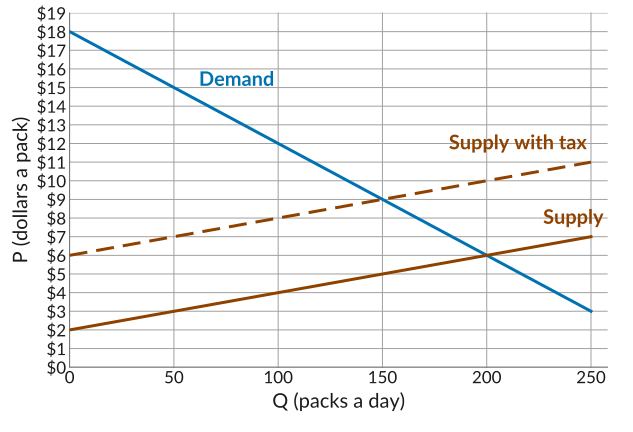
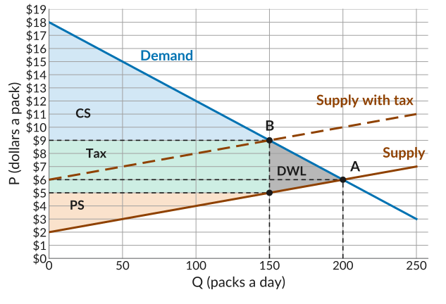
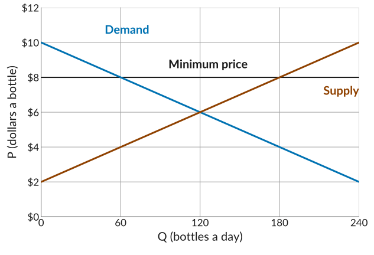
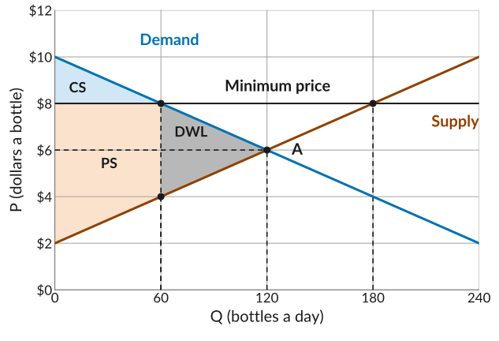

::: {.practice-links}
[Lecture 20 slides](../slides/lecture20.html) · [Module IV: Markets with Many Buyers and Sellers](../content/markets-with-many-buyers-and-sellers.qmd)
:::

Work through each problem on paper before you open its **Solution**.

## 1. A per-pack tax on cigarettes

In California, the tax on cigarettes is about \$4 a pack. Let's see the impact of this tax in a stylized market where many stores sell the same cigarettes. In the graph, the solid lines show the original demand and supply curves. The tax raises sellers' marginal cost of each pack by \$4: the dashed line shows supply with the tax.

{width="600" fig-align="center" fig-alt="A plotting grid, price from 0 to 19 dollars with gridlines every dollar, and packs a day from 0 to 250 with gridlines every 50. Demand falls in a straight line from 18 dollars at zero packs to 3 dollars at 250. Supply rises in a straight line from 2 dollars at zero packs to 7 dollars at 250. A dashed line labelled Supply with tax runs parallel to supply and 4 dollars above it."}

**(a)** What are the equilibrium price and quantity before the tax?

Solution

The equilibrium is where demand crosses supply: **200 packs at \$6**. At that price, smokers want exactly the number of packs that stores want to sell.

**(b)** With the tax, how many packs are sold, what do smokers pay, and what do stores keep?

Solution

Demand crosses supply with the tax at **150 packs**. Smokers pay **\$9**, the height of demand at 150 packs. Stores keep **\$5**, the height of the original supply curve at 150 packs. The \$4 between them goes to the government.

**(c)** How much of the \$4 tax do smokers bear, and how much do stores bear? Calculate each side's share as a percentage.

Solution

Smokers pay $9 - 6 = 3$ more than before, and stores keep $6 - 5 = 1$ less. So smokers bear $3/4 = 75\%$ and stores bear $1/4 = 25\%$, even though the law says sellers pay.

**(d)** Why do smokers bear more of the tax here? What does this mean for a state hoping the tax will cut smoking?

Solution

Demand is steeper than supply, so smokers are the less elastic side. Cigarettes are addictive, so many smokers keep buying at a higher price and stores can pass on much of the tax. Stores can sell other goods instead, so the price they keep falls by less. It also means the tax does not cut smoking by much: here a price 50% higher lowers sales by only 25%.

**(e)** Shade the consumer surplus, the producer surplus, the tax revenue, and the deadweight loss with the tax. What does the deadweight loss represent, and how large is it?

Solution

{width="600" fig-align="center" fig-alt="The cigarette market with the tax. A marks 200 packs at 6 dollars and B marks 150 packs at 9 dollars. Out to 150 packs, the triangle between demand and 9 dollars is shaded blue, labelled CS; the rectangle between 5 and 9 dollars is shaded green, labelled Tax; the triangle between 5 dollars and supply is shaded orange, labelled PS. The triangle from 150 to 200 packs between the curves is shaded grey, labelled DWL."}

The deadweight loss is the 50 packs no longer sold, from 150 to 200. Each was worth more to a smoker than it cost to supply, so those sales would have left both sides better off. The tax pushes the price up by shifting the supply curve, so fewer sales happen than would have at the lower competitive price, and nobody gets that surplus. Using the area of a triangle: $\tfrac{1}{2} \times 50 \times 4 = 100$.

**(f)** Is the deadweight loss you found truly a loss to society? What does the calculation leave out?

Solution

Not necessarily. The calculation counts only smokers and sellers, and leaves out external effects, costs that smoking imposes on others, such as secondhand smoke and health care. If those costs are large enough, the packs no longer sold were worth less to society than they cost, and the tax raises total surplus.

## 2. A minimum price on wine

To cut heavy drinking, Scotland sets a minimum price for alcohol, about \$8 for a bottle of wine. This is a *price floor*: the lowest price a seller can legally charge. Let's see the impact of this price floor in a stylized market where many shops sell the same bottles of wine. The graph shows the demand and supply curves.

{width="600" fig-align="center" fig-alt="A plotting grid, price from 0 to 12 dollars with gridlines every 2 dollars, and bottles a day from 0 to 240 with gridlines every 60. Demand falls in a straight line from 10 dollars at zero bottles to 2 dollars at 240. Supply rises in a straight line from 2 dollars at zero bottles to 10 dollars at 240. A solid line at 8 dollars across the graph is labelled Minimum price."}

**(a)** What are the equilibrium price and quantity?

Solution

The equilibrium is where demand crosses supply: **120 bottles at \$6**.

**(b)** The minimum price is \$8. How many bottles do shops offer, and how many do buyers want? Is there excess demand or excess supply, and how much?

Solution

At \$8, shops offer **180** bottles, read off supply, and buyers want **60**, read off demand. That is an **excess supply of 120** bottles: some shops are left with bottles they cannot sell at that price.

**(c)** How many bottles are sold, and why?

Solution

**60 bottles.** Shops cannot sell bottles that buyers do not want, so trade happens on the short side of the market, here the buyers.

**(d)** Shade the consumer surplus, the producer surplus, and the deadweight loss with the minimum price. Using the area of a triangle, calculate the deadweight loss.

Solution

{width="600" fig-align="center" fig-alt="The wine market with a minimum price of 8 dollars. A marks 120 bottles at 6 dollars. At 60 bottles, demand is at 8 dollars and supply at 4. Out to 60 bottles, the triangle between demand and 8 dollars is shaded blue, labelled CS, and the area between 8 dollars and supply is shaded orange, labelled PS. The triangle from 60 to 120 bottles between the curves is shaded grey, labelled DWL. A solid line at 8 dollars across the graph is labelled Minimum price, and meets supply at 180 bottles."}

The deadweight loss is the triangle over the bottles from 60 to 120. Using the area of a triangle: $\tfrac{1}{2} \times 60 \times (8 - 4) = 120$.

**(e)** Who gains from the minimum price, and who loses?

Solution

Shops that still make their sales gain, since they get \$2 more a bottle. Shops left with unsold bottles lose. Buyers lose: they pay more and buy less.

## 3. Multiple choice

::: {.mcq answer="b"}

**Q1.** A city is deciding how to tax sellers of sandwiches. How does a 20% tax change the supply curve, compared with a flat \$2 tax on each sandwich?

  a. Both shift supply up in parallel, since each adds the same to every unit.
  b. The 20% tax makes supply steeper; the \$2 tax shifts it up in parallel.
  c. The \$2 tax makes supply steeper; the 20% tax shifts it up in parallel.
  d. Both make supply steeper, since each adds more to the costlier units sold.

Solution

A percentage tax adds more dollars to units that cost more, so the gap between the curves widens, while a flat tax adds the same dollars to every unit.

:::

::: {.mcq answer="c"}

**Q2.** A city collects its hotel tax from hotels. Which statement is correct?

  a. Hotels bear all of the tax, since they hand the money to the city.
  b. Guests bear all of the tax, since hotels raise the price by the full tax.
  c. How the tax is shared depends on the elasticities of supply and demand.
  d. Each side bears half of the tax, whichever side hands over the money.

Solution

The burden depends on how each side responds to the price, not on who hands the money to the city.

:::

::: {.mcq answer="b"}

**Q3.** By law, Social Security tax takes 6.2% of pay from the worker, and the employer pays another 6.2%. Suppose workers' supply of labor is less elastic than employers' demand for it. Who bears more of the tax?

  a. Each side bears half, since the law splits the tax evenly.
  b. Workers, since their side of the market is less elastic.
  c. Employers, since they can respond by hiring fewer workers.
  d. Employers, since they send the money to the government.

Solution

The less elastic side bears more of a tax, however the law divides the payment.

:::

::: {.mcq answer="a"}

**Q4.** A government wants to raise revenue with little deadweight loss. Which good should it tax?

  a. A good with inelastic demand, since the quantity falls only a little.
  b. A good with elastic demand, since the quantity falls a lot.
  c. A good with many close substitutes, since buyers can switch.
  d. A good sold by many sellers, since they share the tax equally.

Solution

The deadweight loss comes from sales that no longer happen, so it is small when buyers can't easily switch to something else and few sales are lost.

:::

::: {.mcq answer="b"}

**Q5.** A state taxes gasoline to cut emissions, and the tax raises the price at the pump. Many commuters have no easy alternative to driving, so they find it hard to cut back. What does this mean for the tax?

  a. Demand is elastic, so the tax cuts gas use by a lot.
  b. Demand is inelastic, so the tax does not cut gas use by much.
  c. Demand is inelastic, so the tax cuts gas use by a lot.
  d. Demand is elastic, so the tax does not cut gas use by much.

Solution

With few alternatives to driving, commuters find it hard to cut back, so demand is inelastic and a higher price lowers gas use by less than it would for most goods.

:::

::: {.mcq answer="b"}

**Q6.** After an earthquake, the governor declares an emergency and demand for batteries jumps. California law generally bars stores from raising prices by more than 10% during an emergency. Suppose this keeps the price below the new equilibrium. At that price, stores offer 500 packs a day and shoppers want 800. How many packs are sold?

  a. 800, since buyers decide how much is sold at any price.
  b. 500, since shoppers cannot buy packs stores do not offer.
  c. 650, since the market splits the gap between the two sides.
  d. 300, since that is the size of the excess demand at the cap.

Solution

Trade happens on the short side of the market, here the stores, so some shoppers go without.

:::

::: {.mcq answer="c"}

**Q7.** With a rent ceiling below the equilibrium, 1,000 people want apartments and 600 are offered. Which statement is correct?

  a. The 600 apartments go to the people who value them the most.
  b. Every renter is better off, since rents are now lower for all.
  c. Some renters who value an apartment highly may go without one.
  d. Landlords gain, since all of their apartments are still rented.

Solution

The rent cannot rise to settle who misses out, so something else decides, such as who applied first, and the 600 need not go to those who value them most.

:::

::: {.mcq answer="a,d"}

**Q8.** California has passed laws making it easier to build backyard apartments. A city with high rents could encourage this or set a rent ceiling. Which statements about the two policies are true? Select all that apply.

  a. A ceiling means fewer apartments get rented.
  b. Both leave some renters who cannot find an apartment at that rent.
  c. A ceiling sends apartments to the renters who value them most.
  d. With more building, more apartments get rented at a lower rent.

Solution

A ceiling lowers the rent but landlords offer fewer apartments, so some renters who would gladly pay more go without, while more building shifts supply right, so the rent falls and more apartments are rented.

:::
