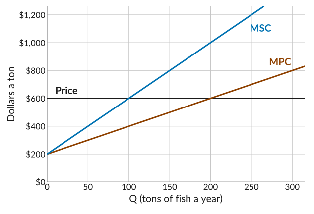
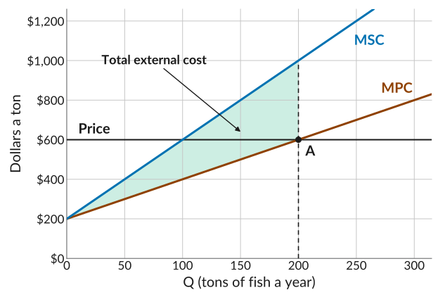
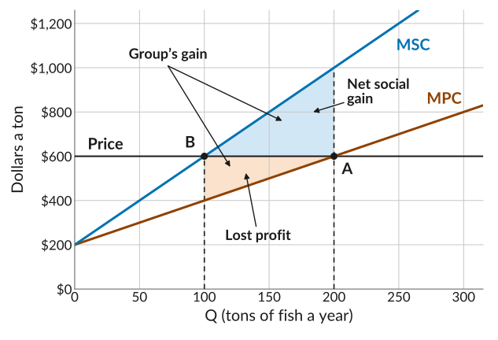

::: {.practice-links}
[Lecture 21 slides](../slides/lecture21.html) · [Module V: Market Successes and Failures](../content/market-successes-and-failures.qmd)
:::

Work through each problem on paper before you open its **Solution**.

## 1. Trawlers and the sea floor

A small fleet of trawl boats works out of a port on the California coast. The boats catch fish by dragging heavy nets along the sea floor, which damages the habitat there. That damage is a cost to the environment, not to the fleet. A conservation group works to protect the sea floor. We assume the fish cannot be caught without trawling. The fleet sells its catch at the dock price of \$600 a ton, and it can sell any amount at that price. The graph shows the fleet's marginal private cost (MPC) of a ton of fish and the marginal social cost (MSC), which adds the habitat cost: the damage that ton does to the sea floor, valued in dollars. Each extra ton means trawling more of the sea floor, so it does more damage than the last.

*Based on a real case: in 2006, a conservation group bought trawl permits and boats from fishermen in Morro Bay, California.*

{width="600" fig-align="center" fig-alt="A plotting grid, dollars a ton from 0 to 1,200 with gridlines every 200 dollars, and tons of fish a year from 0 to 300 with gridlines every 50 tons. The MPC line rises in a straight line from 200 dollars at zero tons to 400 dollars at 100 tons and 600 dollars at 200 tons. The MSC line starts at the same 200 dollars and rises twice as fast, to 600 dollars at 100 tons and 1,000 dollars at 200 tons. A horizontal line at 600 dollars is labelled Price."}

**(a)** How many tons of fish does the fleet catch each year, and why?

Solution

The fleet catches every ton that sells for more than it costs to catch, so it stops where $P = \text{MPC}$: **200 tons a year**. It ignores the damage to the sea floor, because that cost falls on the environment and not on the fleet.

**(b)** What is the marginal external cost (MEC) of the 200th ton, and what does it measure?

Solution

The marginal external cost is the gap between the two lines: $\text{MEC} = \text{MSC} - \text{MPC}$. At 200 tons, that is $1{,}000 - 600 = 400$: the 200th ton does **\$400** of damage to the habitat. The gap widens as the quantity grows. At 100 tons it is only $600 - 400 = 200$.

**(c)** On the graph, shade the area that shows the total external cost when the fleet catches 200 tons a year.

Solution

The total external cost is the MEC of every ton added up: the area between the MSC and MPC lines, out to 200 tons.

{width="600" fig-align="center" fig-alt="The trawling graph with the MPC line, the MSC line, and the price line at 600 dollars. A marks 200 tons on the price line, where it meets the MPC line, with a dashed guide from the horizontal axis up to the MSC line at 1,000 dollars. The triangle between the MPC line and the MSC line, from zero to 200 tons, is shaded green and labelled Total external cost."}

**(d)** Is 200 tons a year Pareto efficient? Think about what happens if the fleet catches one ton less.

Solution

**No.** With one ton less, \$400 of habitat damage is avoided, the MEC of that ton. The fleet loses hardly anything: it gives up \$600 of revenue, but the 200th ton is the one where $P = \text{MPC}$, so it also saves almost \$600 of cost. So the conservation group, which values that habitat, could pay the fleet part of the \$400 to catch 199 tons, and both sides would be better off. An outcome where both can be made better off is not Pareto efficient.

**(e)** What is the Pareto-efficient quantity of fish?

Solution

**100 tons a year**, where $P = \text{MSC}$. The price is what buyers are willing to pay for a ton, the marginal social benefit, so at 100 tons $\text{MSB} = \text{MSC}$. Above 100 tons, a ton costs society more than the \$600 it is worth. At 100, one ton less saves \$200 of habitat and costs the fleet $600 - 400 = 200$, so nobody can gain without someone losing.

**(f)** The boat owners hold government trawl permits, so they have a legal right to trawl, and nothing stops them catching 200 tons a year. A conservation group, bargaining on behalf of the sea floor, wants them to cut back to 100 tons. Who would pay whom? Find the minimum and the maximum payment, using the area of a triangle, $\tfrac{1}{2} \times \text{base} \times \text{height}$.

Solution

{width="600" fig-align="center" fig-alt="The trawling graph with the MPC line, the MSC line, and the price line at 600 dollars. A marks 200 tons on the price line, where it meets the MPC line, and B marks 100 tons on the price line, where it meets the MSC line. Between 100 and 200 tons, the triangle below the price line and above the MPC line, which is at 400 dollars at 100 tons, is shaded orange and labelled Lost profit. The triangle above the price line and below the MSC line, which is at 1,000 dollars at 200 tons, is shaded blue and labelled Net social gain. A third label, Group's gain, points to both shaded areas."}

**The group pays the fleet**, because the fleet holds the right. The minimum the fleet accepts is its lost profit on the tons it gives up, the triangle below the price line: $\tfrac{1}{2} \times 100 \times (600 - 400) = 10{,}000$, or **\$10,000 a year**. The maximum the group pays is the habitat damage avoided, which is both shaded areas: $10{,}000 + \tfrac{1}{2} \times 100 \times (1{,}000 - 600) = 30{,}000$, or **\$30,000 a year**. Any payment in between leaves both sides better off. The gap, the \$20,000 net social gain, is split by bargaining power.

This is what happened in Morro Bay: the fishermen held permits, so the conservation group paid them for their permits and boats.

## 2. Multiple choice

::: {.mcq answer="b,c"}

**Q1.** A music venue holds 100 concerts a year, and the noise keeps the people living next door awake. Select all the statements that are correct.

  a. The marginal private cost is the venue's total cost of holding 100 concerts a year.
  b. The marginal external cost is the cost to the neighbors of one more concert.
  c. The marginal social cost is the venue's cost of one more concert plus the cost to the neighbors.
  d. The total external cost is the venue's own cost of holding all 100 concerts.

Solution

The marginal external cost is what one more concert costs the neighbors, and the marginal social cost adds it to the venue's own cost: $\text{MSC} = \text{MPC} + \text{MEC}$. The marginal private cost is the venue's cost of one more concert, not of all 100, and the total external cost is what all the concerts cost the neighbors, not the venue.

:::

::: {.mcq answer="c"}

**Q2.** Which of these decisions imposes an external cost?

  a. A café raises the price of its coffee, and its regular customers pay more.
  b. A student pays for an evening class and gives up her free time to study.
  c. A restaurant vents its kitchen smoke into the apartments on the floor above.
  d. A bakery buys a new oven that lowers its cost of baking each loaf of bread.

Solution

The smoke is a cost of the restaurant's decision that falls on the neighbors, who are not part of its trades and are not paid for it.

:::

::: {.mcq answer="b"}

**Q3.** Each trip a trucking company runs costs the company \$200 in fuel and wages, and its exhaust costs people living along the route \$50 in health. Which statement is correct?

  a. The marginal private cost is \$250, and the marginal social cost is \$200.
  b. The marginal private cost is \$200, and the marginal social cost is \$250.
  c. The marginal external cost is \$200, and the marginal social cost is \$50.
  d. The marginal external cost is \$250, and the marginal private cost is \$50.

Solution

The company's own cost of a trip is \$200, the cost to others is \$50, and the marginal social cost is the two added together.

:::

::: {.mcq answer="b"}

**Q4.** A firm in a competitive market produces where $P = \text{MPC}$, and its production imposes an external cost on its neighbors. Compared with the Pareto-efficient output, the firm produces:

  a. Too little, since the price is below the marginal social cost.
  b. Too much, since the marginal social cost is above the price.
  c. The efficient amount, since the price equals its marginal cost.
  d. Too much, since its marginal private cost is above the price.

Solution

At the firm's output the last unit costs society more than buyers are willing to pay for it, so cutting output could make both the firm and its neighbors better off.

:::

::: {.mcq answer="b"}

**Q5.** A farm's pesticide harms a fishery downstream, and the farm has the right to use it. Cutting the farm's output to the Pareto-efficient level would cost the farm \$2,000 in lost profit and would gain the fishery \$5,000. Which payment from the fishery to the farm would both sides accept?

  a. \$1,500, since the farm keeps most of its profit.
  b. \$3,500, since it is between \$2,000 and \$5,000.
  c. \$5,500, since it covers the fishery's whole gain.
  d. \$7,000, since it is the two amounts added together.

Solution

The farm accepts any payment above its \$2,000 lost profit and the fishery pays at most its \$5,000 gain, so only a payment between the two leaves both better off.

:::

::: {.mcq answer="b"}

**Q6.** *(CORE Question 10.3)* Consider the situation where the noise of a factory's production affects nurses in the dormitory next door. Suppose there are no transaction costs to impede Coasean bargaining. Read the following statements and choose the correct option.

  a. Whether the final output level will be Pareto efficient depends on who has the initial property rights.
  b. The nurses would be better off in the bargained allocation if they initially had a right to undisturbed sleep than they would if the factory had the right to make noise.
  c. If the factory has the right to make noise, it will prefer not to bargain with the nurses.
  d. The net social gain from robot production goes to whichever party obtains the initial property rights.

Solution

If the factory has the initial rights, the nurses will have to pay for a reduction in noise; if they have the initial rights they will gain both a noise reduction and a payment from the factory. The final allocation is Pareto efficient either way, the factory can be made better off by a payment from the nurses, and how the net social gain is shared depends on bargaining power.

:::

::: {.mcq answer="c"}

**Q7.** A paper mill's waste harms a fishery downstream. One company now buys both the mill and the fishery. What happens to the mill's output?

  a. It rises, since the company now earns money from both paper and fish.
  b. It stays the same, since the cost of making paper has not changed.
  c. It falls, since the harm to the fishery is now the company's own cost.
  d. It falls to zero, since any waste would harm the company's own fishery.

Solution

The external effect is internalized: the lost fish are now the company's own loss, so it cuts the mill's output to the Pareto-efficient level.

:::

::: {.mcq answer="b"}

**Q8.** In Sturges v Bridgman, the court gave a doctor the right to stop the noisy machinery of the candy maker next door. According to Coase, when would the machinery still be used?

  a. Never, since the court had ruled against the candy maker.
  b. If the candy maker gained more from it than it cost the doctor.
  c. If the noise cost the doctor more than the candy maker gained.
  d. Always, since the candy maker had used it for many years.

Solution

The candy maker could then pay the doctor more than the noise cost him to give up his right, and both would be better off.

:::

::: {.mcq answer="c"}

**Q9.** Which of these is a market failure?

  a. A bakery loses customers to a new rival and has to close down its store.
  b. The price of avocados doubles after a drought cuts the harvest in half.
  c. A market outcome where someone could gain without anyone else losing.
  d. A landlord raises the rent, and some of the tenants can no longer pay it.

Solution

A market failure is a market outcome that is not Pareto efficient: some change would make someone better off and no one worse off. In the other cases someone loses, but the market is working.

:::

::: {.mcq answer="b"}

**Q10.** The price of gasoline covers the cost of producing and delivering it, but not the cost of the climate change that burning it causes. As a result:

  a. The price is above the marginal social cost, and too little gasoline is used.
  b. The price is below the marginal social cost, and too much gasoline is used.
  c. The price is equal to the marginal social cost, and the right amount is used.
  d. The price is below the marginal private cost, and too little gasoline is made.

Solution

The price sends the wrong message. It leaves out the external cost, so people use gasoline that costs society more than it is worth to them.

:::
