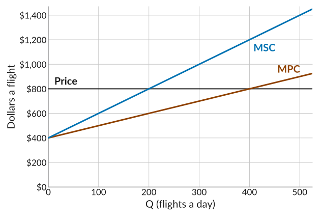
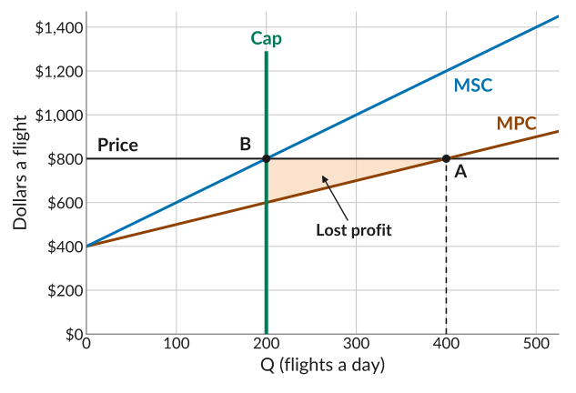
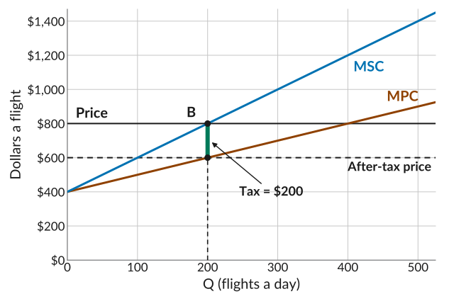
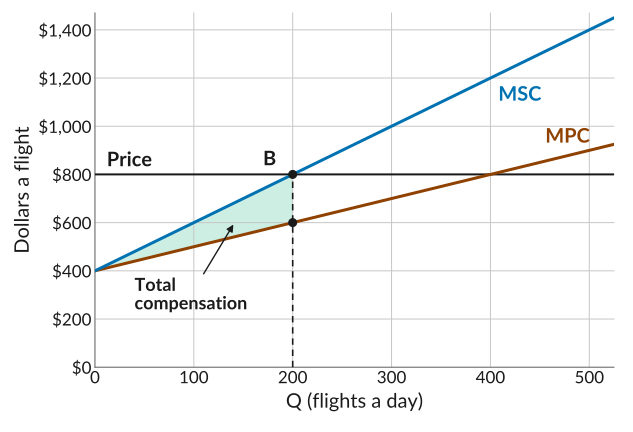

::: {.practice-links}
[Lecture 22 slides](../slides/lecture22.html) · [Module V: Market Successes and Failures](../content/market-successes-and-failures.qmd)
:::

Work through each problem on paper before you open its **Solution**.

## 1. An airport and its neighbors

An airport sits next to a neighborhood, and every flight passes low over the houses. The noise is a cost to the neighbors, not to the airport. We assume the flights cannot be run without the noise. The airport earns \$800 in fees from each flight, and it can run as many flights as it likes at that price. The graph shows the airport's marginal private cost (MPC) of a flight and the marginal social cost (MSC), which adds the noise cost: what that flight costs the neighbors, valued in dollars. Each extra flight means flying earlier in the morning or later at night, so it costs the neighbors more than the last.

*Based on a real case: John Wayne Airport in Orange County, where a 1985 settlement with Newport Beach residents set a night curfew and a cap on passengers.*

{width="600" fig-align="center" fig-alt="A plotting grid, dollars a flight from 0 to 1,400 with gridlines every 200 dollars, and flights a day from 0 to 500 with gridlines every 100 flights. The MPC line rises in a straight line from 400 dollars at zero flights to 600 dollars at 200 flights and 800 dollars at 400 flights. The MSC line starts at the same 400 dollars and rises twice as fast, to 800 dollars at 200 flights and 1,200 dollars at 400 flights. A horizontal line at 800 dollars is labelled Price."}

**(a)** How many flights a day does the airport run? What is the Pareto-efficient number of flights?

Solution

The airport runs every flight that earns more than it costs the airport, so it stops where $P = \text{MPC}$: **400 flights a day**, point A. It ignores the noise, because that cost falls on the neighbors and not on the airport. The Pareto-efficient number is where $P = \text{MSC}$: **200 flights a day**, point B. Above 200 flights, a flight costs society more than the \$800 it earns.

**(b)** *Solution 2, regulation.* The city caps the airport at 200 flights a day. How much profit does the airport lose? Use the area of a triangle, $\tfrac{1}{2} \times \text{base} \times \text{height}$.

Solution

{width="600" fig-align="center" fig-alt="The airport graph with the MPC line, the MSC line, and the price line at 800 dollars. A marks 400 flights on the price line, where it meets the MPC line, and B marks 200 flights on the price line, where it meets the MSC line. A thick green vertical line at 200 flights is labelled Cap. Between 200 and 400 flights, the triangle below the price line and above the MPC line, which is at 600 dollars at 200 flights, is shaded orange and labelled Lost profit."}

On each flight between 200 and 400, the airport loses the surplus it would have made, $P - \text{MPC}$. Added up, that is the triangle below the price line: $\tfrac{1}{2} \times 200 \times (800 - 600) = 20{,}000$. The airport's lost profit is **\$20,000 a day**, and nobody pays it for that.

**(c)** *Solution 3, a Pigouvian tax.* Instead of a cap, the city taxes every flight. What is the marginal external cost (MEC) of the 200th flight? What tax per flight gets the airport to choose 200 flights? How much does the city collect each day?

Solution

{width="600" fig-align="center" fig-alt="The airport graph with the MPC line, the MSC line, and the price line at 800 dollars, meeting the MSC line at B, 200 flights. A dashed horizontal line at 600 dollars, labelled After-tax price, meets the MPC line at 200 flights. A thick green vertical segment at 200 flights, from 600 dollars up to 800 dollars, is labelled Tax equals 200 dollars."}

The marginal external cost is the gap between the two lines: $\text{MEC} = \text{MSC} - \text{MPC}$. At 200 flights, that is $800 - 600 = 200$: the 200th flight costs the neighbors **\$200** in noise. The tax is the MEC at B: **\$200 a flight**. The airport now keeps $800 - 200 = 600$ dollars from each flight, so it stops where its MPC is \$600: 200 flights. The city collects \$200 on each of them, $200 \times 200 = 40{,}000$: **\$40,000 a day**.

**(d)** *Solution 4, compensation.* Instead, the city makes the airport pay the neighbors the MEC of every flight. How many flights does the airport run? On the graph, shade the total compensation it pays.

Solution

{width="600" fig-align="center" fig-alt="The airport graph with the MPC line, the MSC line, and the price line at 800 dollars, meeting the MSC line at B, 200 flights, with a dashed guide down to the horizontal axis. The triangle between the MPC line and the MSC line, from zero to 200 flights, where the lines are 200 dollars apart, is shaded green and labelled Total compensation."}

The airport's cost of a flight becomes $\text{MPC} + \text{MEC} = \text{MSC}$, so it stops where $P = \text{MSC}$: **200 flights a day**. The total compensation is the MEC of every flight it still runs: the area between the MSC and MPC lines, out to 200 flights.

**(e)** Compare the three policies. Under which is the airport worst off? Under which are the neighbors best off? Is any of them a Pareto improvement on 400 flights?

Solution

- **Cap at 200 flights:** the airport loses \$20,000 of profit. The neighbors' noise cost falls. The city gets nothing.
- **\$200 tax:** the airport loses that profit and pays \$40,000. The neighbors' noise cost falls. The city gets \$40,000.
- **Compensation:** the airport loses that profit and pays \$20,000. The neighbors are fully compensated. The city gets nothing.

All three reach 200 flights, and in all three the polluter pays. The **airport is worst off with the tax**: it loses the same profit under each policy, and the tax takes the most on top. The compensation is the shaded triangle in part (d), $\tfrac{1}{2} \times 200 \times 200 = 20{,}000$. The **neighbors are best off with compensation**: the noise falls as much as under the other two, and they are also paid for the noise that remains. **None is a Pareto improvement**: the airport ends up worse off than at 400 flights under every one.

## 2. Multiple choice

::: {.mcq answer="b"}

**Q1.** A factory's smoke harms the people living nearby. To move the factory to the Pareto-efficient output, a Pigouvian tax on each unit it makes should equal:

  a. The marginal private cost at the output the factory chooses now.
  b. The marginal external cost at the Pareto-efficient output.
  c. The marginal social cost at the Pareto-efficient output.
  d. The total external cost divided by the factory's output.

Solution

The tax stands in for the cost the factory ignores. With the tax, the factory's own cost of one more unit is its MPC plus the tax, so it stops at the efficient output only if the tax is the MEC there.

:::

::: {.mcq answer="a"}

**Q2.** A brewery sells kegs at \$100 each, and its waste harms a river. At the Pareto-efficient output, its marginal private cost is \$70. What Pigouvian tax per keg gets it to that output?

  a. \$30, the price minus the marginal private cost.
  b. \$70, the brewery's marginal private cost at that output.
  c. \$100, the full price that the brewery gets for each keg.
  d. \$170, the price and the marginal private cost added up.

Solution

At the efficient output the price equals the MSC, so the MEC is $100 - 70 = 30$. A \$30 tax leaves the brewery \$70 a keg, and it stops where its MPC is \$70.

:::

::: {.mcq answer="b"}

**Q3.** Under liability law, a carmaker must pay for the injuries caused by a design fault in its cars. How does this law reduce harm?

  a. The government collects the payments and spends them on road safety.
  b. Carmakers expect to pay for the harm, so they take more care.
  c. Carmakers are told how many cars they are allowed to sell each year.
  d. Buyers and carmakers bargain over safety before every sale.

Solution

The payment comes after the harm, but the rule is known beforehand. A carmaker that expects to pay for injuries counts that cost when it designs the car.

:::

::: {.mcq answer="b,c,d"}

**Q4.** A city can move a polluting factory to the Pareto-efficient output with a cap, a Pigouvian tax, or compensation paid to the neighbors. Select all the statements that are correct.

  a. The factory makes the same profit under all three policies.
  b. The neighbors' pollution cost falls under all three policies.
  c. Only the tax brings in revenue for the government.
  d. Only compensation pays the neighbors for the harm that remains.

Solution

All three cut output, so the harm falls. But the cap takes nothing more from the factory, the tax sends its payment to the government, and compensation sends it to the neighbors, so the factory's profit is not the same.

:::

::: {.mcq answer="d"}

**Q5.** A power plant produces where $P = \text{MPC}$, and its smoke harms a town. Which of these would be a Pareto improvement on that outcome?

  a. A cap that cuts the plant's output to the efficient level.
  b. A Pigouvian tax equal to the marginal external cost.
  c. A law that makes the plant pay the town for the harm.
  d. A bargain in which the town pays the plant to cut back.

Solution

Under the three government policies the plant ends up worse off than before, so someone loses. In the bargain the plant is paid at least its lost profit and the town pays less than it gains, so both are better off.

:::

::: {.mcq answer="a,b,c"}

**Q6.** Which of these is a challenge for a government trying to fix an external cost? Select all the statements that are correct.

  a. A cap needs the right quota for each firm when firms differ in size.
  b. A Pigouvian tax needs the marginal external cost at the efficient output.
  c. Compensation needs the harm from each unit to be measured.
  d. A Pigouvian tax cannot change how much a firm chooses to produce.

Solution

Each policy needs information that is hard to get, because marginal social costs are difficult to measure. But a tax does change the firm's choice: it lowers what the firm keeps from each unit, so the firm makes fewer.

:::

::: {.mcq answer="c"}

**Q7.** Newer planes are much quieter than older ones, and airlines choose which planes to fly. A city wants less noise around its airport. Which policy gives airlines a reason to switch to quieter planes?

  a. A cap on the number of flights each day.
  b. A tax of the same amount on every flight.
  c. A charge on each flight based on its noise.
  d. A cap on the number of passengers each year.

Solution

The noise is the problem, not the flights. Under a cap or a flat tax a quiet plane is treated the same as a loud one, so only a charge on the noise itself makes a loud plane cost more to fly. It is the lesson of chlordecone: the pesticide was the problem, not the bananas.

:::

::: {.mcq answer="d"}

**Q8.** A homeowner plants shade trees that cool the whole block, and the neighbors pay nothing for it. This is:

  a. A negative externality, so too many trees are planted.
  b. A negative externality, so too few trees are planted.
  c. A positive externality, so too many trees are planted.
  d. A positive externality, so too few trees are planted.

Solution

The shade is a benefit to others that the homeowner is not paid for. She counts only her own benefit, so she plants fewer trees than the block as a whole would want.

:::

::: {.mcq answer="a,b,d"}

**Q9.** A flu shot protects the person who gets it, and also the people that person would have infected. Select all the statements that are correct.

  a. The private benefit of a flu shot is below its social benefit.
  b. Left to their own choices, too few people get a flu shot.
  c. A tax on flu shots would bring the number closer to the efficient one.
  d. A subsidy for flu shots would bring the number closer to the efficient one.

Solution

People weigh only their own benefit, not the protection they give to others, so too few get the shot. A subsidy pays them for that benefit to others. A tax would push the number down further.

:::

::: {.mcq answer="a,b,d"}

**Q10.** Governments use regulation, taxes and subsidies to deal with external effects. Select all the policies that are regulation.

  a. A ban on lead in gasoline.
  b. A yearly cap on the passengers at an airport.
  c. A charge on each ton of carbon dioxide from fuel.
  d. A rule that children be vaccinated to attend school.

Solution

Regulation tells people what they may or must do: a ban, a cap, or a requirement. A charge on carbon dioxide is a Pigouvian tax: it leaves the choice to the firm but raises the price of polluting.

:::
