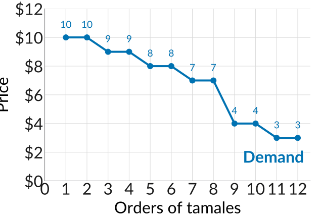
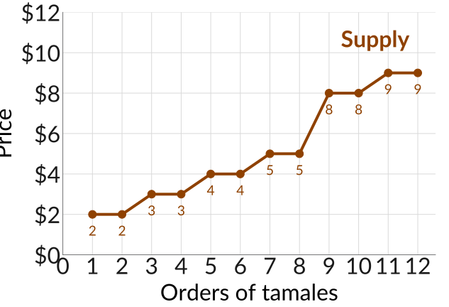
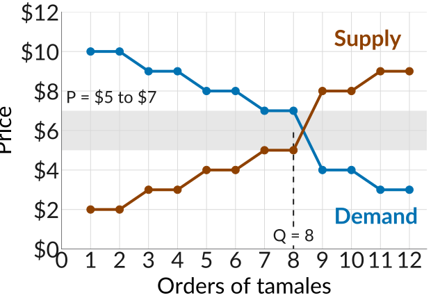
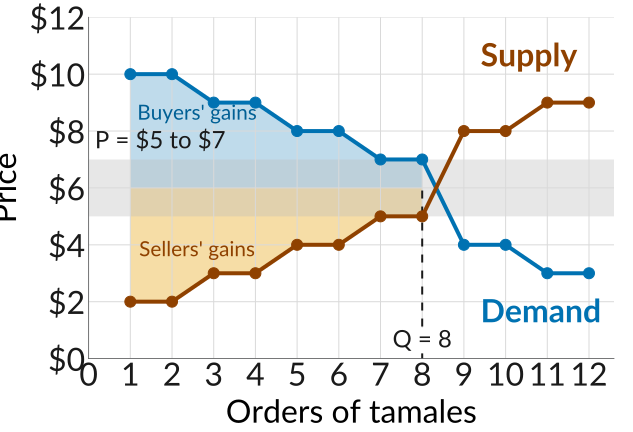

## So Far: Firms That Set Prices

-   We have studied how firms set prices: a car company selling a specialty car, a brand of cereal like Cheerios, AT&T and T-Mobile picking prices strategically.
-   Each sold a differentiated product. Nothing else on the market was a perfect substitute for it.
-   That gave them *market power*: they could charge above marginal cost, because no rival could undercut them and take all their customers.
-   Wanda kept her loyal customers at the high price, and how much Cheerios could mark up depended on how elastic its demand was.

## Markets Where No One Picks the Price

-   Many sellers have no such power. Think of three taco stands at a Saturday flea market: the same tacos, no brand, a few steps apart, so buyers walk around and compare. Is any one of them picking the price?
-   Where goods are hard to tell apart and there are many sellers, firms take the price as given: used textbooks, raw cotton, produce at a farmers market.
-   Where does that price come from, and where does it settle? Before the model, we build such a market here.

## The Game

::: tighteq
-   Half of you are buyers and half are sellers of half a dozen tamales. Each of you gets one card; keep its number private.
-   *Buyers*: the number on your card is your *value*, the most the tamales are worth to you. Find a seller who will sell for less.

    $$\text{Buyer's gain} = \text{value} - \text{price}$$

-   *Sellers*: the number on your card is your *cost*. Find a buyer who will pay more.

    $$\text{Seller's gain} = \text{price} - \text{cost}$$

-   When a pair agrees, come to the front with your cards and I record it. One trade each per round, never at a loss. Five minutes a round, then we reshuffle.
:::

## What Happened to Prices?

-   Where did the Round 1 prices land, and how spread out were they?
-   Did the prices settle as the rounds went on? Around what number?
-   How many trades happened in each round? Who could not find a trade, and why?

## From Cards to a Demand Curve

:::::: columns
:::: {.column width="46%"}
-   Say 12 buyers and 12 sellers hold our cards. The buyer cards, highest first: 10, 10, 9, 9, 8, 8, 7, 7, 4, 4, 3, 3.
-   At \$8, who buys? Everyone at 8 or above: six buyers. At \$4, ten.
-   Lined up this way, the cards are the *demand curve*: at each price, how many want to buy.
::::

::: {.column width="54%"}
{fig-alt="A plot with orders of tamales from 0 to 12 on the horizontal axis and price from 0 to 12 dollars on the vertical axis, gridlines at every order and every 2 dollars. A blue line labelled Demand joins one dot per buyer, falling from 10 dollars for the first two orders to 9, 9, 8, 8, 7, 7, 4, 4, 3, and 3 for the twelfth, each dot labelled with its value."}
:::
::::::

## From Cards to a Supply Curve

:::::: columns
:::: {.column width="46%"}
-   The twelve seller cards, lowest first: 2, 2, 3, 3, 4, 4, 5, 5, 8, 8, 9, 9.
-   At \$8, who sells? Everyone at 8 or below: ten sellers. At \$4, six.
-   Lined up this way, the cards are the *supply curve*: at each price, how many are willing to sell.
::::

::: {.column width="54%"}
{fig-alt="The same axes. An orange line labelled Supply joins one dot per seller, rising from 2 dollars for the first two orders to 3, 3, 4, 4, 5, 5, 8, 8, 9, and 9 for the twelfth, each dot labelled with its cost."}
:::
::::::

## Why the Price Ends Up Where They Cross

:::::: columns
:::: {.column width="46%"}
-   At \$8: ten sellers, six buyers. Four sellers find no one and cut their price. That is *excess supply*.
-   At \$4: ten buyers, six sellers. Buyers with no seller offer more. That is *excess demand*.
-   From \$5 to \$7 the counts match, eight and eight, and no one has a reason to move. That is the *equilibrium price* and *quantity*, and where your prices settled.
::::

::: {.column width="54%"}
{fig-alt="The demand and supply lines on one plot. They cross between the eighth and ninth order: at the eighth, demand is at 7 dollars and supply at 5. A grey band from 5 to 7 dollars is labelled P equals 5 to 7 dollars, and a dashed vertical line at 8 orders is labelled Q equals 8."}
:::
::::::

## Who Trades and Who Does Not

:::::: columns
:::: {.column width="46%"}
-   The eighth order pairs a cost of 5 with a value of 7. At \$6 each gains \$1, so it happens.
-   The ninth would pair a value of 4 with a cost of 8. No price suits both. The market leaves out exactly the trades that lose value.
-   The gains on the eight orders add up to $2 \times (8 + 6 + 4 + 2) = 40$, the most possible. The shading is that *surplus*: at \$6, \$20 to buyers and \$20 to sellers.
::::

::: {.column width="54%"}
{fig-alt="The same plot. Over the first eight orders, the area between the demand line and 6 dollars is shaded blue and labelled buyers' gains, and the area between 6 dollars and the supply line is shaded orange and labelled sellers' gains. Nothing is shaded beyond 8 orders, where supply sits above demand."}
:::
::::::

## Price-Takers

-   A seller who asked more than the going price lost the sale to another seller, and a buyer who offered less found no seller. Each of you could only agree or walk away.
-   Buyers and sellers who cannot gain by trading at any price other than the going price are *price-takers*. No one can move the price, but anyone can trade at it.
-   A market where the quantity supplied equals the quantity demanded at the going price, and everyone is a price-taker, is in *competitive equilibrium*. That is where the later rounds ended up.
