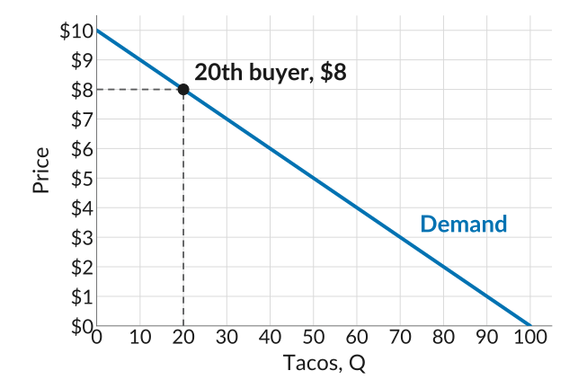
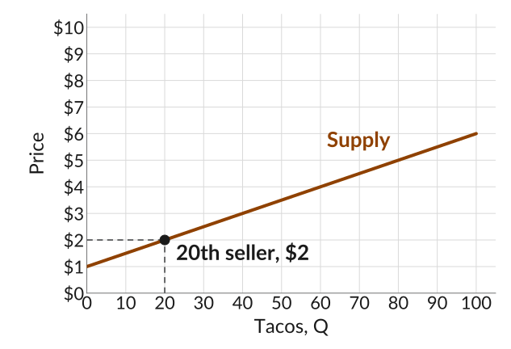
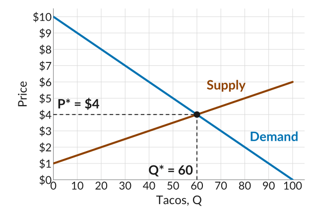
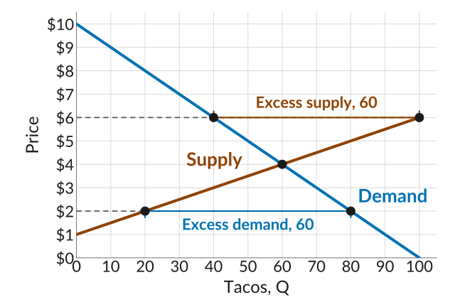

## Competitive Markets

-   For the next few lectures, we will focus on markets with *many buyers* and *many sellers*.
-   Before the midterm, we were analyzing markets for differentiated goods, where there are *many buyers* but only *one seller* of a specific good.
-   Sellers of differentiated goods face competition from sellers of similar products, but in markets with many sellers of the same product, competition is more intense.
-   In *competitive markets*, sellers have no control over the price and have to sell at the going market price, so they are *price-takers*, e.g., the taco stands at the flea market.
-   Prices in these markets are determined by the interaction of *supply* and *demand*.

## Demand for Tacos

::: plain
*Demand*: how many tacos shoppers want to buy at each price.
:::

:::::: columns
:::: {.column width="46%"}
-   A buyer only buys a taco if the price is at most what they value it at, i.e., their *willingness to pay (WTP)*.
-   Line up the shoppers by WTP, highest first, and plot it: the *demand curve*.
-   The first would pay at most \$10, the 20th \$8: 20 buyers have $\text{WTP} \geq \$8$.
::::

::: {.column width="54%"}
{fig-alt="A straight line falling from 10 dollars at zero tacos to zero at 100 tacos, labelled Demand, with price on the vertical axis from 0 to 10 dollars in steps of 1 and tacos on the horizontal axis from 0 to 100 in steps of 10. A point at 20 tacos and 8 dollars is labelled 20th buyer, 8 dollars, with dashed guides to both axes."}
:::
::::::

## Supply of Tacos

::: plain
*Supply*: how many tacos stands want to sell at each price.
:::

:::::: columns
:::: {.column width="46%"}
-   A seller only sells a taco if the price is at least its cost, i.e., its *willingness to accept (WTA)* or *reservation price*.
-   Line up the sellers by WTA, lowest first, and plot it: the *supply curve*.
-   The first would sell for at least \$1, the 20th for \$2: 20 sellers have $\text{WTA} \leq \$2$.
::::

::: {.column width="54%"}
{fig-alt="A straight line rising from 1 dollar at zero tacos to 6 dollars at 100 tacos, labelled Supply, on the same axes. A point at 20 tacos and 2 dollars is labelled 20th seller, 2 dollars, with dashed guides to both axes."}
:::
::::::

## How Do Prices Get Set?

-   Shoppers can walk around and find the cheapest stand, so no stand can charge more than the others and still sell. It is plausible to think there will be close to a single price.
-   If this *price is too high*, many stands want to sell but few shoppers want to buy. Stands with unsold tacos have an incentive to *lower their price*.
-   If the *price is too low*, many shoppers want to buy but few stands want to sell. Shoppers who go without are willing to pay more, so stands have an incentive to *raise their price*.
-   Only at the price where the number of tacos shoppers want equals the number stands offer does nobody have an incentive to change: no shopper is left wanting a taco at that price, and no stand is left with unsold tacos. This is the *market-clearing* or *equilibrium* price.

## Market Clearing

:::::: columns
:::: {.column width="46%"}
-   *Market-clearing price*: the quantity demanded equals the quantity supplied.
-   Here, the curves cross at $Q^* = 60$ and $P^* = \$4$. So in equilibrium, 60 tacos are bought and sold at \$4 each.
-   60 buyers are willing to pay \$4 or more, and 60 sellers to accept \$4 or less: every buyer finds a seller and every seller a buyer.
::::

::: {.column width="54%"}
{fig-alt="The demand and supply lines on one plot. They cross at 60 tacos and 4 dollars, marked with a dot and dashed guides labelled P star equals 4 dollars on the price axis and Q star equals 60 on the quantity axis."}
:::
::::::

## Why the Price Settles at \$4

:::::: columns
:::: {.column width="46%"}
-   At \$6, only 40 tacos are wanted but 100 are offered: an *excess supply* of 60. Stands with unsold tacos have an incentive to lower their price.
-   At \$2, 80 are wanted but only 20 offered: an *excess demand* of 60. Shoppers who go without will pay more, so stands have an incentive to raise their price.
-   Only at \$4, with 60 wanted and 60 offered, does nobody have an incentive to change.
::::

::: {.column width="54%"}
{fig-alt="The demand and supply lines with two prices marked. At 6 dollars, a dot on the demand line at 40 tacos and a dot on the supply line at 100, joined by a bracket labelled excess supply, 60. At 2 dollars, a dot on the supply line at 20 tacos and a dot on the demand line at 80, joined by a bracket labelled excess demand, 60. A dot marks the crossing at 60 tacos and 4 dollars."}
:::
::::::

## The Pit Market Experiment

:::::: columns
:::: {.column width="46%"}
-   Last class, your buyer and seller cards gave your willingness to pay and willingness to accept. Lined up, they give the demand and supply curves on the right.
-   Over the rounds, as everyone learned more about the going prices, [your trades](https://www.dbhagia.com/econ201/experiment/market-board.html) settled close to the market-clearing price and quantity.
-   Other experiments find the same.
::::

::: {.column width="54%"}
{fig-alt="The experiment's demand and supply lines on one plot, orders of tamales from 0 to 12 on the horizontal axis and price from 0 to 12 dollars on the vertical axis. Demand falls in steps from 10 dollars to 3 dollars, and supply rises in steps from 2 dollars to 9 dollars. They cross between the eighth and ninth order: at the eighth, demand is at 7 dollars and supply at 5. A grey band from 5 to 7 dollars is labelled P equals 5 to 7 dollars, and a dashed vertical line at 8 orders is labelled Q equals 8."}
:::
::::::

## Where Buyers and Sellers Meet

-   Buyers and sellers need a way to find each other and to see what others are offering. At the flea market, shoppers walk from stand to stand, as you did in this room.
-   Bazaars, the big city markets for meat, fish, and flowers, and the corn exchanges where farmers once sold grain to merchants all put many buyers and sellers in one place.
-   Online, eBay works the same way. A buyer's maximum bid is their WTP, and a seller's reserve price is their WTA.
-   The more easily buyers and sellers can compare offers, the faster the price settles at the market-clearing level.

## Cotton, War, and the Lancashire Mills

-   In 1861, raw cotton grown in the American South fed the textile mills of Lancashire, in England.
-   When the Civil War broke out, President Lincoln ordered the Navy to blockade the Confederate ports. Cotton exports almost stopped: a few ships slipped through, but 1,500 were destroyed or captured.
-   Far less cotton reached England, so at the old price there was a large *excess demand*. Sellers realized they could raise the price, and cotton eventually sold at six times its pre-war price.
-   Mills used half as much cotton as before, and hundreds of thousands of mill workers lost their jobs.

## The Message Spreads

-   For the mill owners, the price rise was a rise in costs. Some failed and left the industry. Others switched to cotton from India, so demand for Indian cotton jumped.
-   Excess demand for Indian cotton let its sellers raise prices too, almost to the level of US cotton. Farmers in India, Brazil, and Egypt abandoned other crops and grew cotton instead.
-   Indian cotton needed different processing. Within months, new machinery was developed, and the firms that made it saw their profits take off as every mill rushed to retool.
-   Nobody ordered any of this. Millions of strangers, each making the best of a new situation, reorganized world cotton production in a matter of months.

## Prices Are Messages

-   The rise in the price of US cotton told everyone: find other sources, and find new ways to use them.
-   When the price of gas rises, the message to the driver is "take the train," and the message passed on to the railroad is "there are profits in running more trains." A higher price for electricity tells a household to think about solar panels.
-   A price rises when more people want a good, or it has become costlier to produce, or both. Someone who responds by finding an alternative saves money, and also saves a scarce resource for everyone else.

## Markets or Planners?

-   In a centrally planned economy, like the Soviet Union before the 1990s, government experts decide what gets produced and send out the instructions. Inside a large firm like Walmart, managers do the same.
-   In a market, no one sends the messages. They come out of the interaction of millions of people, through prices.
-   The economist Friedrich Hayek argued that this is what markets do best: they get the right information to the right people. A price measures how scarce a good is, but only if it is free to move with supply and demand.
-   Which system makes better use of what people know is still debated today.
