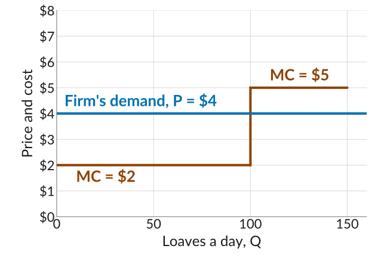
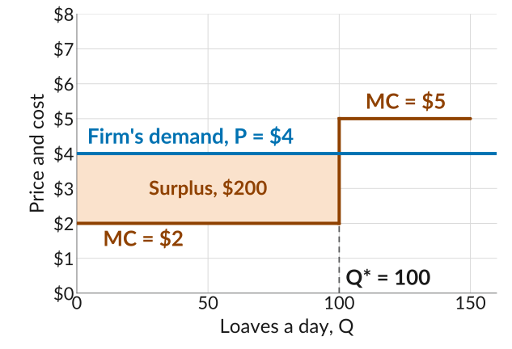
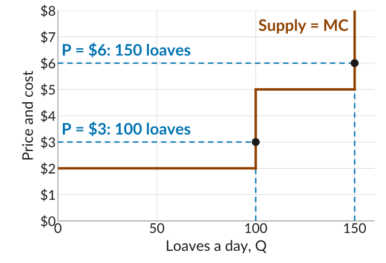
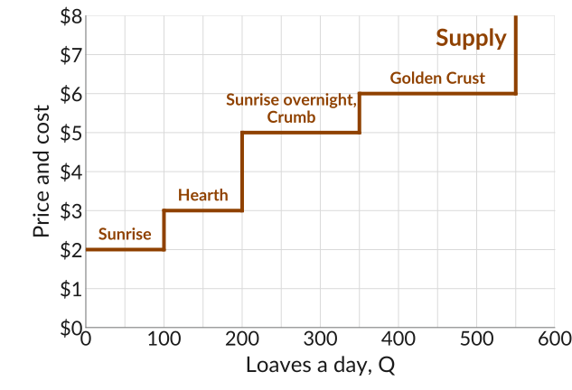
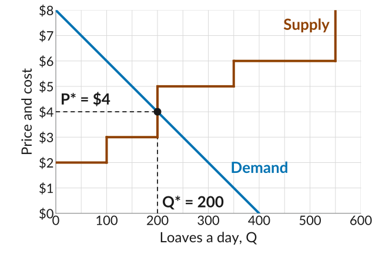

## Last Class: Supply and Demand

-   In *competitive markets*, many sellers offer the same good, so they are *price-takers*: they sell at the going market price.
-   *Demand*: how many units buyers want at each price. *Supply*: how many units sellers want to sell at each price.
-   At the *market-clearing* or *equilibrium* price, the quantity demanded equals the quantity supplied, and nobody has an incentive to change.
-   At any other price there is excess supply or excess demand, and sellers have an incentive to lower or raise their price.

::: plain
*Today*: what it means to take the price as given, and how a firm decides how much to produce when it cannot choose its price.
:::

## Finding the Equilibrium With Algebra

::: plain
Last class's taco curves are straight lines, so we can find where they cross with algebra.
:::

:::::: columns
:::: {.column width="46%"}
-   Demand: $P = 10 - Q/10$. Supply: $P = 1 + Q/20$.
-   At the equilibrium both give the same price: $10 - Q/10 = 1 + Q/20$.
-   So $9 = Q/10 + Q/20 = 3Q/20$, and $Q^* = 60$.
-   Then $P^* = 10 - 60/10 = 4$. Supply gives $1 + 60/20 = 4$ too.
::::

::: {.column width="54%"}
{fig-alt="The taco market from last class: a demand line falling from 10 dollars at zero tacos to zero at 100 tacos, and a supply line rising from 1 dollar at zero tacos to 6 dollars at 100 tacos, with price on the vertical axis in steps of 1 dollar and tacos on the horizontal axis in steps of 10. They cross at 60 tacos and 4 dollars, marked with a dot and dashed guides labelled P star equals 4 dollars and Q star equals 60."}
:::
::::::

## Price-Takers

::: plain
A *price-taker* cannot gain by trading at any price other than the going market price. They cannot move the price, but they can buy or sell as much as they like at it.
:::

-   At \$4, a stand asking \$5 sells nothing, because shoppers go to the stands asking \$4. A stand asking \$3 gives money away, since shoppers will pay \$4.
-   A shopper offering \$3 finds no seller, and one offering \$5 overpays.
-   Buyers are price-takers when there are many other buyers. Sellers are price-takers when many sellers offer an identical good. On both sides, competition removes bargaining power.

## Competitive Equilibrium

-   A market is in *competitive equilibrium* when the quantity supplied equals the quantity demanded at the going price, and every buyer and seller is a price-taker.
-   It is a *Nash equilibrium*: given that everyone else trades at \$4, no one can do better than trading at \$4 too.
-   The model needs two things. Many buyers and sellers, so that what any one of them trades is small next to the whole market. And identical goods, so that buyers can switch from one seller to another.

## Price Setters and Price-Takers

::: {.fixedtable .wide .smaller}
| Market | Sellers | Buyers |
|:--|:--|:--|
| A differentiated product, e.g. Cheerios | *One seller, a price setter*. No one else sells Cheerios, so it can raise its price and still keep buyers. | *Many buyers, price-takers*. A buyer who offered less would be refused, because many others will pay. |
| Competitive equilibrium, e.g. tacos at the flea market | *Many sellers, price-takers*. A stand asking more than \$4 sells nothing, because shoppers go elsewhere. | *Many buyers, price-takers*. A shopper offering less than \$4 finds no seller. |

: {tbl-colwidths="[24,38,38]"}
:::

## Firms That Take the Price as Given

::: plain
Now look at one seller in a competitive market. How much should a price-taking firm produce?
:::

-   A firm selling a differentiated product faces a downward-sloping demand curve and chooses its price.
-   When products are identical and buyers switch freely, a firm cannot charge more than the going price. It is a price-taker.
-   *Example*: Sunrise Bakery is one of many bakeries in town selling the same sourdough loaf. The going price is \$4 a loaf.
-   Sunrise can bake up to 100 loaves a day at a marginal cost of \$2, and up to 50 more on an overnight shift at \$5 each. Its fixed costs are \$120 a day.

## The Firm's Demand Curve

:::::: columns
:::: {.column width="46%"}
-   Above \$4, Sunrise sells nothing: customers walk to the next bakery. At \$4, it can sell as many loaves as it likes.
-   So its demand curve is flat at \$4, and its only choice is how many loaves to bake.
-   Its marginal cost steps up from \$2 to \$5 at 100 loaves.
::::

::: {.column width="54%"}
{fig-alt="Price and cost on the vertical axis from 0 to 8 dollars and loaves a day on the horizontal axis from 0 to 150. A flat blue line at 4 dollars runs across the whole width, labelled Firm's demand, P equals 4 dollars. The marginal cost is a step: flat at 2 dollars from 0 to 100 loaves, labelled MC equals 2 dollars, then jumping to 5 dollars from 100 to 150 loaves, labelled MC equals 5 dollars."}
:::
::::::

## How Many Loaves?

:::::: columns
:::: {.column width="46%"}
-   Each of the first 100 loaves adds $4 - 2 = 2$ to profit.
-   Each overnight loaf would lose $5 - 4 = 1$.
-   So Sunrise bakes $Q^* = 100$: every loaf whose marginal cost is below the price.
-   Its surplus is $(4 - 2) \times 100 = 200$, the shaded area. Profit is $200 - 120 = 80$.
::::

::: {.column width="54%"}
{fig-alt="The same plot, with the rectangle between the marginal cost of 2 dollars and the price of 4 dollars, from 0 to 100 loaves, shaded light orange and labelled Surplus, 200 dollars. A dashed guide at 100 loaves is labelled Q star equals 100."}
:::
::::::

## The Firm's Supply Curve

:::::: columns
:::: {.column width="46%"}
-   A price-taking firm takes the market price and chooses a quantity by comparing it with marginal cost.
-   Below \$2, Sunrise bakes nothing. Between \$2 and \$5, it bakes 100. Above \$5, it bakes 150.
-   So the marginal cost curve is the firm's *supply curve*: at each price, the quantity it produces.
::::

::: {.column width="54%"}
{fig-alt="The marginal cost step curve drawn as a supply curve, labelled Supply equals MC: flat at 2 dollars to 100 loaves, a vertical riser to 5 dollars, flat at 5 dollars to 150 loaves, then a vertical riser up. Two dashed blue price lines read quantities off it: at 3 dollars, 100 loaves, and at 6 dollars, 150 loaves, each marked with a dot."}
:::
::::::

## Adding Up the Bakeries

:::::: columns
:::: {.column width="46%"}
-   Three more bakeries: Hearth bakes up to 100 loaves at \$3, Crumb 100 at \$5, and Golden Crust 200 at \$6.
-   *Market supply* adds up what every bakery bakes at each price, lowest marginal cost first. At \$4, that is 200 loaves.
-   Its height at each quantity is the marginal cost of that loaf: the 150th loaf costs \$3.
::::

::: {.column width="54%"}
{fig-alt="A staircase supply curve, price and cost from 0 to 8 dollars and loaves a day from 0 to 600. Flat at 2 dollars from 0 to 100 loaves, labelled Sunrise; at 3 dollars from 100 to 200, labelled Hearth; at 5 dollars from 200 to 350, labelled Sunrise overnight, Crumb; at 6 dollars from 350 to 550, labelled Golden Crust; then a vertical riser at 550. The whole curve is labelled Supply."}
:::
::::::

## Competitive Equilibrium in the Bread Market

:::::: columns
:::: {.column width="46%"}
-   Lined up highest first, the $Q$th buyer in town will pay $8 - Q/50$. At \$4, that is 200 buyers.
-   Supply equals demand at $P^* = \$4$ and $Q^* = 200$. Sunrise and Hearth bake; Crumb and Golden Crust do not.
-   The going price that Sunrise takes as given is set by supply and demand in the whole market.
::::

::: {.column width="54%"}
{fig-alt="The staircase supply curve with a demand line falling from 8 dollars at zero loaves to zero at 400 loaves. They cross on the vertical riser at 200 loaves, at 4 dollars, marked with a dot and dashed guides labelled P star equals 4 dollars and Q star equals 200."}
:::
::::::

## With Many Bakeries

:::::: columns
:::: {.column width="46%"}
-   With 50 bakeries instead of four, the supply curve has dozens of small steps, so we draw it as a smooth line.
-   The market supply curve is the marginal cost curve for all the bread in town: its height at $Q$ is the cost of the $Q$th loaf.
-   In equilibrium, the 200th buyer's willingness to pay and the 200th loaf's marginal cost both equal the price, \$4.
::::

::: {.column width="54%"}
{fig-alt="A straight supply line rising from 2 dollars at zero loaves to 8 dollars at 600 loaves, and the demand line falling from 8 dollars at zero to zero at 400 loaves. They cross at 200 loaves and 4 dollars, marked with a dot and dashed guides labelled P star equals 4 dollars and Q star equals 200."}
:::
::::::

## What to Do Next

-   *Quiz 6 is Monday, October 26*, and covers Lectures 15 and 16.
-   To prepare, go over the *slides*, *worksheets*, textbook readings (sections *8.1* to *8.4*), and *practice problems* for both lectures.
