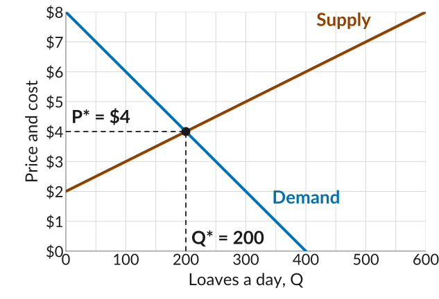
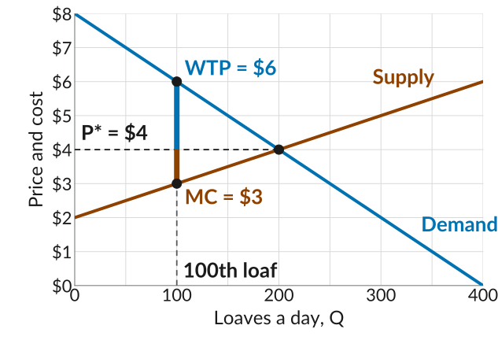
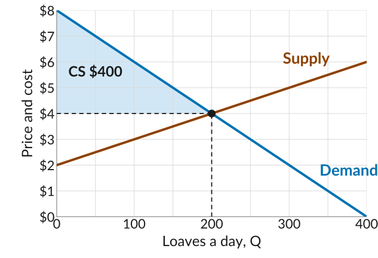
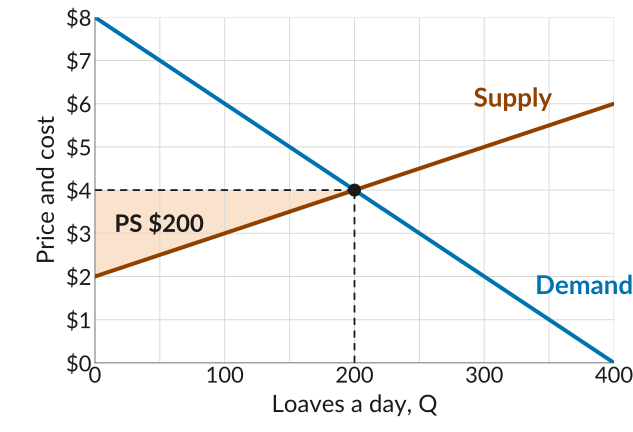
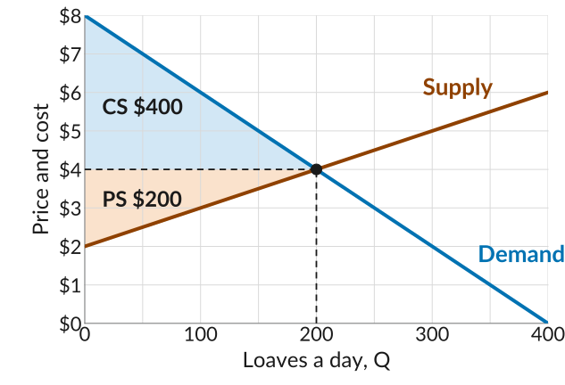
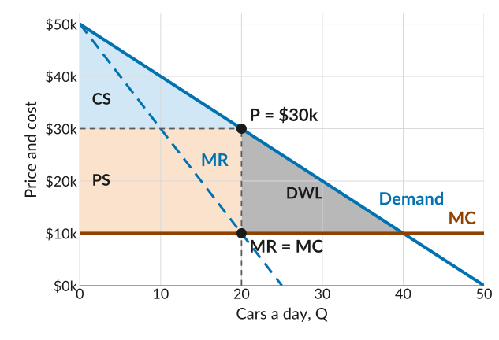
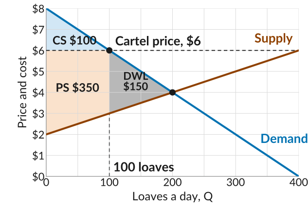
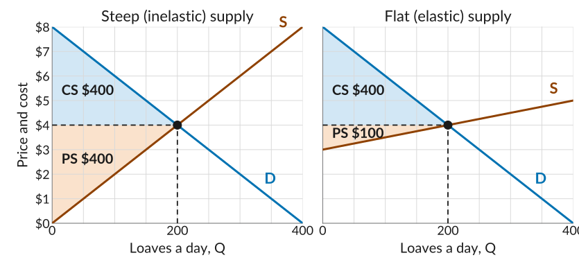
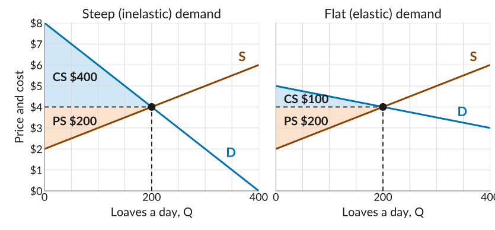

## Last Class: The Bread Market

:::::: columns
:::: {.column width="46%"}
-   With many bakeries selling the same loaf, each is a *price-taker*.
-   The supply curve is the marginal cost of the $Q$th loaf, and the demand curve is the $Q$th buyer's willingness to pay.
-   They cross at $P^* = \$4$ and $Q^* = 200$ ($\text{WTP} = \text{MC}$).
::::

::: {.column width="54%"}
{fig-alt="A straight supply line rising from 2 dollars at zero loaves to 8 dollars at 600 loaves, and a demand line falling from 8 dollars at zero to zero at 400 loaves. They cross at 200 loaves and 4 dollars, marked with a dot and dashed guides labelled P star equals 4 dollars and Q star equals 200."}
:::
::::::

::: plain
*Today*: who gains from these trades, how the gains are split, and whether the market leaves any gains on the table.
:::

## The Gains From One Loaf

::: plain
Buyers and bakeries trade because both gain. The *gains from trade* are what each side gets from a trade compared with not trading at all.
:::

:::::: columns
:::: {.column width="46%"}
-   The 100th buyer would pay up to \$6 but pays \$4, so they gain $6 - 4 = 2$.
-   The 100th loaf costs \$3 to bake and sells for \$4, so the bakery gains $4 - 3 = 1$.
-   Every buyer who gets a loaf gains $\text{WTP} - P$, and every loaf sold earns its bakery $P - \text{MC}$, whoever buys from whom.
::::

::: {.column width="54%"}
{fig-alt="The bread market, loaves a day from 0 to 400 on the horizontal axis and price and cost from 0 to 8 dollars on the vertical axis. The demand line falls from 8 dollars to zero at 400 loaves and the supply line rises from 2 dollars to 6 dollars at 400 loaves; they cross at 200 loaves and 4 dollars, with a dashed price line at P star equals 4 dollars. At 100 loaves, labelled 100th loaf, a dot on the demand line is labelled WTP equals 6 dollars and a dot on the supply line is labelled MC equals 3 dollars. A thick blue segment runs from 4 up to 6 dollars and a thick orange segment from 3 up to 4 dollars."}
:::
::::::

## Consumer Surplus

::: plain
*Consumer surplus (CS)*: the sum of $\text{WTP} - P$ over every loaf bought.
:::

:::::: columns
:::: {.column width="46%"}
-   Every buyer up to the 200th gains the gap between the demand curve and the price.
-   Added up: $\text{CS} = \tfrac{1}{2} \times 200 \times (8 - 4) = 400$.
::::

::: {.column width="54%"}
{fig-alt="The same demand and supply lines, with dashed guides to the equilibrium at 200 loaves and 4 dollars. The triangle between the demand line and the price line at 4 dollars, from zero to 200 loaves, is shaded light blue and labelled CS, 400 dollars."}
:::
::::::

## Producer Surplus

::: plain
*Producer surplus (PS)*: the sum of $P - \text{MC}$ over every loaf sold.
:::

:::::: columns
:::: {.column width="46%"}
-   Every loaf up to the 200th earns its bakery the gap between the price and the supply curve.
-   Added up: $\text{PS} = \tfrac{1}{2} \times 200 \times (4 - 2) = 200$.
-   Producer surplus is profit plus fixed costs.
::::

::: {.column width="54%"}
{fig-alt="The same lines, with the triangle between the dashed price line at 4 dollars and the supply line, from zero to 200 loaves, shaded light orange and labelled PS, 200 dollars."}
:::
::::::

## Total Surplus

::: plain
*Total surplus*: consumer surplus plus producer surplus, the gains from all the trades in the market.
:::

:::::: columns
:::: {.column width="46%"}
-   Total surplus is $400 + 200 = 600$, the whole shaded area.
-   Buyers get two thirds of it and bakeries one third.
-   Notice any difference from the surplus in the market for Beautiful Cars?
::::

::: {.column width="54%"}
{fig-alt="The same lines with both areas shaded: the light blue consumer surplus triangle above the price line, labelled CS, 400 dollars, and the light orange producer surplus triangle below it, labelled PS, 200 dollars, both running from zero to 200 loaves."}
:::
::::::

## No Deadweight Loss

::: plain
Beautiful Cars priced above marginal cost, at the quantity where MR = MC, so buyers who valued a car above its cost went without: a *deadweight loss*.
:::

:::::: columns
:::: {.column width="50%"}
{width="88%" fig-alt="Beautiful Cars: price and cost from 0 to 50 thousand dollars on the vertical axis, cars a day from 0 to 50 on the horizontal. The demand line falls from 50 thousand dollars to zero at 50 cars, the dashed marginal revenue line falls twice as steeply, and marginal cost is flat at 10 thousand dollars. Marginal revenue meets marginal cost at 20 cars, marked MR equals MC, below the point on the demand curve at 20 cars and 30 thousand dollars, marked P equals 30k. The triangle between the demand line and the price from zero to 20 cars is shaded light blue and labelled CS, the rectangle between the price and marginal cost from zero to 20 cars is shaded light orange and labelled PS, and the triangle between the demand line and marginal cost from 20 to 40 cars is shaded grey and labelled DWL."}
::::

::: {.column width="50%"}
{width="88%" fig-alt="The bread market with both surpluses shaded up to 200 loaves: consumer surplus, 400 dollars, above the price of 4 dollars and producer surplus, 200 dollars, below it. Nothing is left unshaded between the curves up to the equilibrium."}
:::
::::::

::: plain
In the bread market, every loaf worth more than it costs gets baked: a competitive equilibrium maximizes the total surplus.
:::

## A Bread Cartel

::: plain
One way to see this: suppose the bakeries form a *cartel*. They agree to charge \$6 and to bake only what buyers want at that price, 100 loaves.
:::

:::::: columns
:::: {.column width="50%"}
-   Buyers: $\text{CS} = \tfrac{1}{2} \times 100 \times 2 = 100$.
-   Bakeries: $\text{PS} = 3 \times 100 + \tfrac{1}{2} \times 100 \times 1 = 350$.
-   The trades between 100 and 200 no longer happen: a deadweight loss of $\tfrac{1}{2} \times 100 \times 3 = 150$. Total surplus falls to \$450.
-   A price held *below* \$4 would leave trades undone too.
::::

::: {.column width="50%"}
{fig-alt="The same demand and supply lines with a dashed horizontal line at 6 dollars labelled Cartel price, 6 dollars. A dot marks where it meets the demand line at 100 loaves, and a dashed guide at 100 loaves is labelled 100 loaves. The triangle between the demand line and the 6 dollar line from zero to 100 loaves is shaded light blue and labelled CS, 100 dollars; the area between the 6 dollar line and the supply line from zero to 100 loaves is shaded light orange and labelled PS, 350 dollars; and the triangle between the demand and supply lines from 100 to 200 loaves is shaded grey and labelled DWL, 150 dollars. A dot marks the equilibrium at 200 loaves and 4 dollars."}
:::
::::::

## Is the Outcome Pareto Efficient?

-   An allocation is *Pareto efficient* if no feasible change could make someone better off without making anyone worse off.
-   Since all the gains from trade are exhausted, no change in how many loaves are baked, or in who bakes and who buys them, can make a buyer or bakery better off without hurting another.
-   So the equilibrium allocation is Pareto efficient, provided nobody outside the market is affected by the trades. If baking were noisy or polluting, the neighbours' costs would have to count too.
-   An *external effect* is a cost or benefit that one person's action imposes on others, which the person acting does not take into account.

## When Does This Result Hold?

::: plain
The Pareto efficiency of a competitive equilibrium is often read as a strong argument for markets. It holds only under four conditions.
:::

-   Many buyers and sellers of identical goods.
-   The market is at its equilibrium, with everyone a price-taker.
-   Trade in the market has no external effects.
-   Each trade is governed by a *complete contract*: one that covers everything either side cares about and can be enforced at almost no cost.

## In Practice

-   Most firms sell goods that are differentiated in some way, as we saw before the midterm. Even bakeries selling identical loaves differ in location, service, and what else they sell.
-   Evidence of price-taking is hard to find.
-   Many goods have external effects, such as the carbon emissions from producing them.
-   Contracts are sometimes incomplete. The buyer of a used car cannot tell whether it is reliable.

## Who Gets the Gains?

:::::: columns
:::: {.column width="46%"}
-   Efficiency is one criterion for judging an allocation. Fairness is another.
-   Surpluses say nothing about fairness, but they do show how the gains are split.
-   Here buyers get 2/3 and sellers 1/3 of the surplus, because demand is steeper than supply.
::::

::: {.column width="54%"}
{fig-alt="The bread market again with both surpluses shaded: the consumer surplus triangle above the price line of 4 dollars, labelled CS, 400 dollars, is twice the size of the producer surplus triangle below it, labelled PS, 200 dollars."}
:::
::::::

## Elasticity of Supply and the Split

::: plain
The *elasticity of supply* measures how much the quantity supplied responds to the price. A flat supply curve is elastic, a steep one inelastic.
:::

{.nostretch width="80%" fig-alt="Two panels with the same demand line and the same equilibrium at 200 loaves and 4 dollars, consumer surplus shaded blue and labelled CS, 400 dollars, in both. In the first, labelled Steep (inelastic) supply, the supply line rises from zero at zero loaves to 8 dollars at 400 loaves, and the producer surplus, shaded orange, is labelled PS, 400 dollars. In the second, labelled Flat (elastic) supply, it rises from 3 dollars to 5 dollars, and the producer surplus is labelled PS, 100 dollars."}

## Elasticity of Demand and the Split

{.nostretch width="80%" fig-alt="Two panels with the same supply line, rising from 2 dollars to 6 dollars, and the same equilibrium at 200 loaves and 4 dollars, producer surplus shaded orange and labelled PS, 200 dollars, in both. In the first, labelled Steep (inelastic) demand, the demand line falls from 8 dollars at zero loaves to zero at 400 loaves, and the consumer surplus, shaded blue, is labelled CS, 400 dollars. In the second, labelled Flat (elastic) demand, it falls from 5 dollars to 3 dollars, and the consumer surplus is labelled CS, 100 dollars."}

## Elasticity and the Split

-   A buyer's gain on a loaf is their willingness to pay minus the price, and a bakery's is the price minus marginal cost. Each side's surplus adds up these gaps.
-   When demand is inelastic, many buyers value bread well above \$4 and would pay far more than they do, so buyers gain a lot. When it is elastic, most buyers would pay only a little more than \$4, and would walk away if it rose, so they gain little.
-   The same goes for supply. Inelastic supply means many loaves cost well below \$4 to bake; elastic supply means most loaves cost nearly \$4.
-   So how the gains are split depends on the relative elasticities of demand and supply: the less elastic side keeps more.
