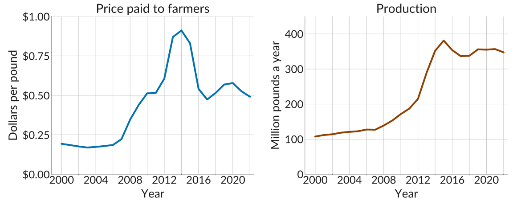
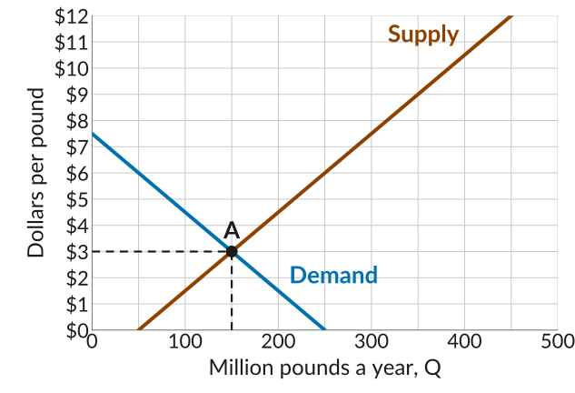
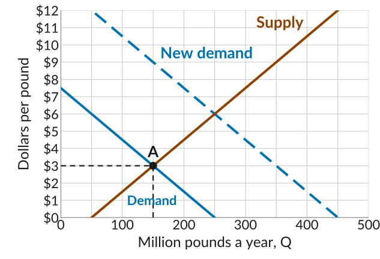
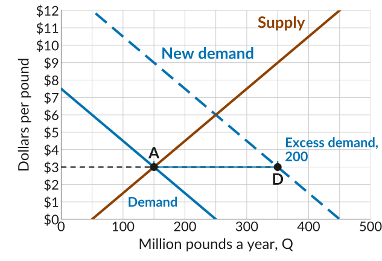
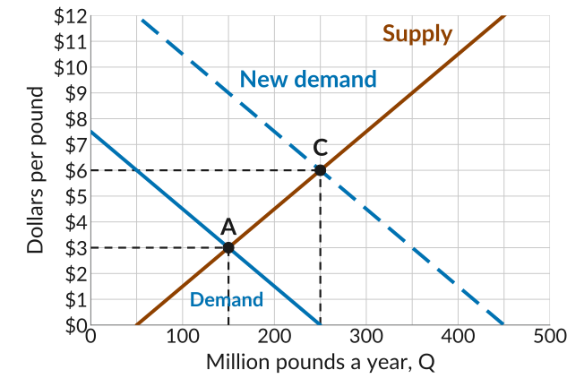
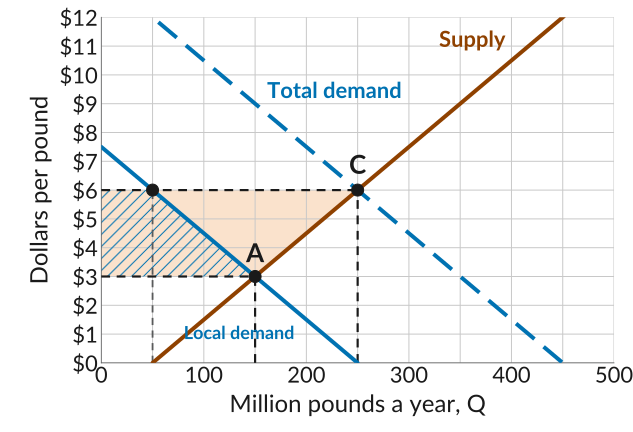
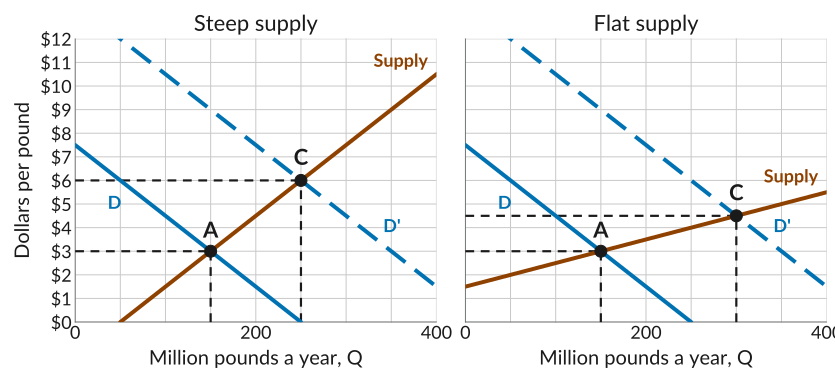

## The Quinoa Boom

{.nostretch width="100%" fig-alt="Two panels for quinoa in Peru and Bolivia from 2000 to 2022. Left, in blue, the price paid to farmers in dollars per pound, averaged across the two countries: near 20 cents until 2007, rising past 50 cents by 2009 and to about 1 dollar 30 in 2014, then falling back to about 50 cents by 2016 and staying there through 2022. Right, in orange, production in million pounds a year: about 115 in 2000, 170 in 2010, 250 in 2013, a jump to 400 in 2014, then between 320 and 375 through 2022."}

::: source
Source: FAOSTAT, producer prices and crop production for Peru and Bolivia.
:::

## What Happened

-   Quinoa is a staple food grown on the Altiplano, high in the Andes of Peru and Bolivia.
-   In the 2000s, as its nutritional properties became known, consumers in Europe and North America started buying it, leading to an increase in demand for quinoa.
-   The price paid to farmers rose several times over and production more than doubled. After 2014 the price fell by more than half while output held up.
-   Uneven gains at home: the staple food became expensive for poor consumers, while farmers, who are among the poorest, gained from the export sales.

::: plain
*Today*: apply the supply and demand framework to understand the dynamics of this market.
:::

## Before the Boom

::: plain
A stylized quinoa market: dollars per pound, million pounds a year.
:::

:::::: columns
:::: {.column width="46%"}
-   Demand is the buyers in Peru and Bolivia, lined up by willingness to pay.
-   Supply is the marginal cost of each pound grown, lowest first.
-   The market clears at A: 150 million pounds a year at \$3 a pound.
::::

::: {.column width="54%"}
{fig-alt="A supply and demand graph, million pounds a year from 0 to 500 on the horizontal axis and dollars per pound from 0 to 12 on the vertical, with gridlines every 50 million pounds and every dollar. The demand line falls from 7 dollars 50 at zero to zero at 250; the supply line rises from zero at 50 million pounds to 12 dollars at 450. They cross at A, 150 million pounds and 3 dollars, with dashed dashed guides to both axes dollars and Q equals 150."}
:::
::::::

## Foreign Buyers Arrive

:::::: columns
:::: {.column width="46%"}
- In economics we think of such changes as *exogenous shocks* to the market: something changes outside the model, and we ask how the market responds.
- Here the shock is an increase in demand, which can be represented as a *shift of the demand curve* to the right. 
- With foreign buyers, the total demand for quinoa is 250 million pounds more at each price.
::::

::: {.column width="54%"}
{fig-alt="The quinoa market, million pounds a year from 0 to 500 and dollars per pound from 0 to 12. The demand line falls from 7 dollars 50 at zero to zero at 250, the supply line rises from zero at 50 million pounds, and they cross at A, 150 million pounds and 3 dollars, with dashed guides. A dashed line parallel to the demand line and 200 million pounds further right, entering the plot at 12 dollars and 50 million pounds and falling to zero at 450, is labelled New demand."}
:::
::::::

## Excess Demand at the Old Price

:::::: columns
:::: {.column width="46%"}
-   At \$3, buyers at home and abroad want 350 million pounds, but farmers grow 150.
-   That is an *excess demand* of 200: buyers who cannot find quinoa at \$3.
-   Farmers and traders who see this can earn more by raising the price and growing more.
::::

::: {.column width="54%"}
{fig-alt="The same graph with the dashed 3 dollar line run out from A at 150 million pounds to the new demand line at 350, marked D. A blue bracket between the two points is labelled Excess demand, 200."}
:::
::::::

## The New Equilibrium

:::::: columns
:::: {.column width="46%"}
-   The market clears where the new demand curve meets supply, at C: 250 million pounds at \$6.
-   The extra pounds cost more to grow, so the price has to rise to bring them in.
-   This explains the initial price rise and the increase in the quantity produced.
::::

::: {.column width="54%"}
{fig-alt="The same graph with the new equilibrium C where the dashed new demand line meets the supply line, at 250 million pounds and 6 dollars, with dashed guides to both axes dollars and Q equals 250. The old equilibrium A at 150 and 3 dollars is still marked, with grey dashed guides to both axes dollars and Q equals 150."}
:::
::::::

## What an Increase in Demand Means

-   Demand is higher at each possible price: a *shift in the demand curve*.
-   In response, the equilibrium price changes. At the old price, sellers find they can sell more quinoa than before.
-   Sellers respond to this price message by increasing the quantity supplied: a *movement along the supply curve*.
-   The supply curve itself has not shifted: farmers' marginal costs have not changed. The quantity supplied rose because the price changed.

## How Does This Adjustment Really Happen?

-   At \$3 everyone was a price-taker, and no one knows the new equilibrium price is \$6.
-   A trader who sells out and turns buyers away realises some would pay more. She raises her price, becoming a *price-maker* for a while and earning a *disequilibrium rent*: profit above what keeps her in business.
-   Others do the same, and farmers grow more, since quinoa now sells above marginal cost. The pushing stops at \$6, where the market clears and everyone is a price-taker again.
-   With excess supply it runs the other way: unsold stock piles up, a buyer offers less than the going price, a seller with full shelves takes it, and the price falls until the market clears.

## Who Gained and Who Lost

:::::: columns
:::: {.column width="46%"}
-   At \$6, local buyers take 50 million pounds, read off the local demand curve, and the other 200 are exported.
-   Farmers gain the orange strip: \$3 more on every pound, and 100 million more pounds sold.
-   Local buyers lose the hatched strip: \$3 more on what they still buy, and most stop buying.
::::

::: {.column width="54%"}
{fig-alt="The same graph at the new equilibrium C, 250 million pounds at 6 dollars, with the solid line labelled Local demand and the dashed line Total demand. An orange strip between the 3 dollar and 6 dollar lines runs from the price axis out to the supply line, between A at 150 and C at 250: the farmers' gain. A blue hatched strip under the local demand line, between the same two prices, runs from the price axis out to 50 million pounds at 6 dollars and 150 at 3 dollars: the local buyers' loss."}
:::
::::::

## When Supply Is Steep

::: plain
The same surge in demand, with a steep and a flat supply curve through A.
:::

{.nostretch width="84%" fig-alt="Two panels with the same demand shift, from the line labelled D to the dashed line labelled D prime, and the old equilibrium A at 150 million pounds and 3 dollars. In the first, labelled Steep supply, the supply line rises from zero at 50 million pounds and the new equilibrium C is at 250 million pounds and 6 dollars. In the second, labelled Flat supply, the supply line rises from 1 dollar 50 and the new equilibrium C is at 300 million pounds and 4 dollars 50."}

::: plain
Growing more quinoa on the Altiplano is costly, so supply is steep: the boom showed up mostly in the price and less in output.
:::

## What to Do Next

-   *Quiz 7 is Monday, November 2*, and covers Lectures 17 and 18.
-   To prepare, go over the *slides*, *worksheets*, textbook readings (sections *8.5* and *8.6*), and *practice problems* for both lectures.
