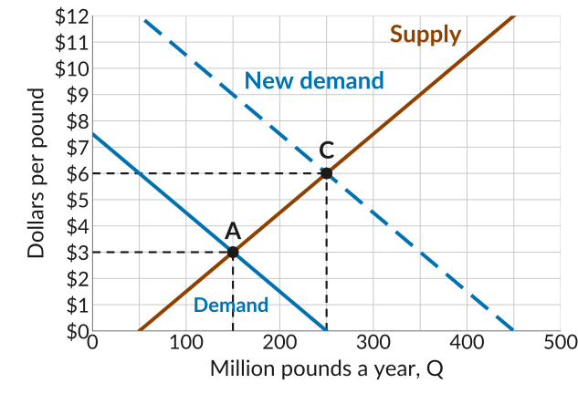
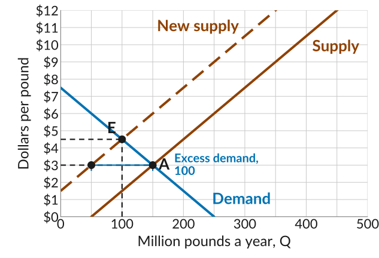
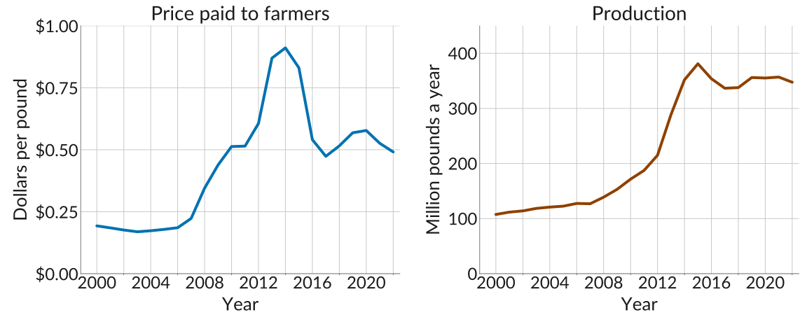
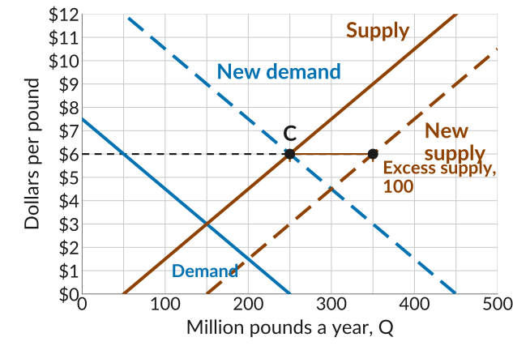
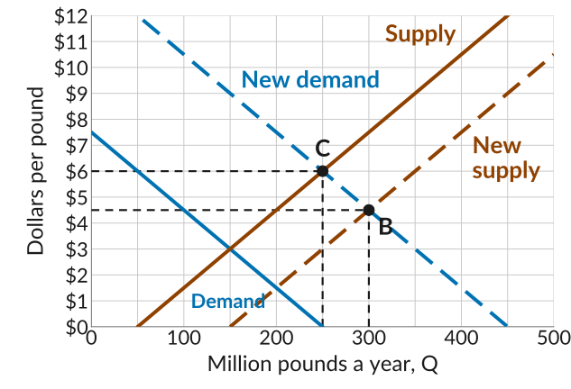
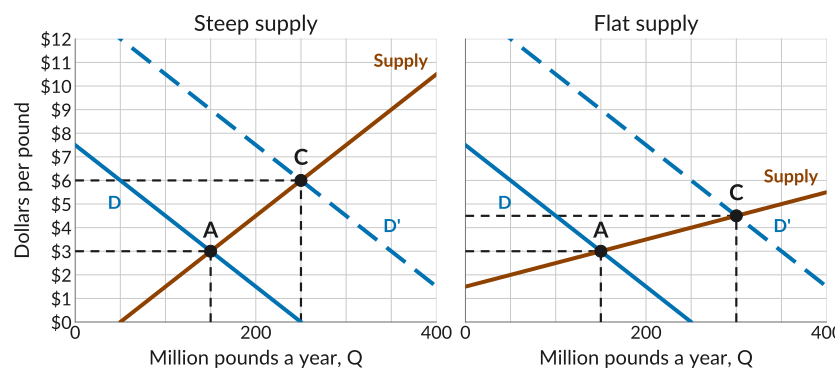
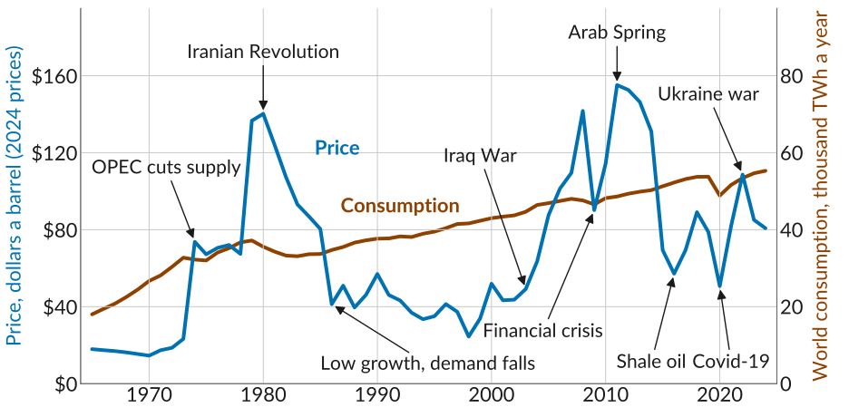

## A Shift in Demand

:::::: columns
:::: {.column width="46%"}
-   Last class, demand for quinoa rose at every price: a *shift in the demand curve*.
-   At the old price of \$3 there was *excess demand*, so the price rose and farmers grew more: a *movement along the supply curve*.
-   The market moved from A to C: from 150 million pounds at \$3 to 250 million pounds at \$6.
::::

::: {.column width="54%"}
{fig-alt="The quinoa market, million pounds a year from 0 to 500 and dollars per pound from 0 to 12, with the demand line, the supply line, and a dashed new demand line 200 million pounds further right. The old equilibrium A is at 150 million pounds and 3 dollars; the new equilibrium C, where the new demand line meets the supply line, is at 250 million pounds and 6 dollars, each with dashed guides to both axes."}
:::
::::::

## A Shift in Supply

::: plain
The supply curve can shift too. As a hypothetical, suppose that before the boom a drought raised the cost of every pound by \$3.
:::

:::::: columns
:::: {.column width="46%"}
-   Supply shifts up by \$3, the same as left by 100.
-   At \$3, farmers grow 50 but buyers want 150: an *excess demand* of 100.
-   The price rises until the market clears at E, 100 million pounds at \$4.50: a movement along the demand curve.
::::

::: {.column width="54%"}
{fig-alt="The quinoa market, million pounds a year from 0 to 500 and dollars per pound from 0 to 12. The demand line falls from 7 dollars 50 at zero to zero at 250. The supply line rises from zero at 50 million pounds, and a dashed line labelled New supply runs 3 dollars above it, from 1 dollar 50 at zero. The old equilibrium A is at 150 million pounds and 3 dollars; a blue bracket at 3 dollars from the new supply line at 50 to A is labelled Excess demand, 100. The new equilibrium E, where demand meets the new supply line, is at 100 million pounds and 4 dollars 50, with dashed guides to both axes."}
:::
::::::

## The Quinoa Boom

{.nostretch width="100%" fig-alt="Two panels for quinoa in Peru and Bolivia from 2000 to 2022, each a three-year moving average. Left, in blue, the price paid to farmers in dollars per pound, averaged across the two countries: near 20 cents until 2007, rising to about 50 cents by 2010 and about 90 cents in 2013 and 2014, then falling back to about 55 cents by 2016 and staying between 45 and 60 cents through 2022. Right, in orange, production in million pounds a year: about 110 in 2000, 170 in 2010, rising to about 380 in 2015, then between 335 and 360 through 2022."}

::: plain
A shift in demand alone would have kept the price high. So why did it come back down?
:::

## More Land, More Farmers

:::::: columns
:::: {.column width="46%"}
-   In the *long run*, high prices drew more land and more farmers into quinoa, so a *shift in the supply curve*.
-   At \$6, farmers would grow 350 million pounds, but buyers want 250: an *excess supply* of 100.
-   Growers with unsold quinoa accept lower offers, and farmers whose costs exceed the lower price grow less, until the market clears.
::::

::: {.column width="54%"}
{fig-alt="The same graph with both demand lines, the supply line, and a dashed line parallel to the supply line and 100 million pounds further right, labelled New supply. A dashed horizontal line at 6 dollars runs from C at 250 million pounds to the new supply line at 350, and an orange bracket between them is labelled Excess supply, 100."}
:::
::::::

## The Price Comes Back Down

:::::: columns
:::: {.column width="46%"}
-   The market clears where the new demand curve meets the new supply curve, at B: 300 million pounds at \$4.50.
-   Price falls and quantity rises. Demand did not shift: the quantity demanded rose from 250 to 300 because the price fell, a movement along the demand curve.
-   This explains why quinoa prices stabilized again.
::::

::: {.column width="54%"}
{fig-alt="The same graph with the new equilibrium B where the dashed new demand line meets the dashed new supply line, at 300 million pounds and 4 dollars 50, with dashed guides to both axes. The previous equilibrium C at 250 and 6 dollars is still marked with dashed guides."}
:::
::::::

## Why Does the Supply Curve Shift?

:::::: columns
:::: {.column width="50%" style="align-self: flex-start;"}
*Short run*: the number of firms and their capacity are fixed.

-   A new technology lowers marginal cost, so supply shifts right.
-   A drought raises marginal cost, so supply shifts left.
-   Producers agree to sell less, or a war disrupts production, so supply shifts left.
::::

:::: {.column width="50%" style="align-self: flex-start;"}
*Long run*: firms can invest, enter, or leave.

-   Economic profit draws in new firms and new capacity, so supply shifts right.
-   Losses drive firms out of the market, so supply shifts left.
::::
::::::

::: plain
Another way of thinking of the long run: supply is more elastic.
:::

## When Supply Is Steep

::: plain
The same surge in demand, with a steep and a flat supply curve through A.
:::

{.nostretch width="84%" fig-alt="Two panels with the same demand shift, from the line labelled D to the dashed line labelled D prime, and the old equilibrium A at 150 million pounds and 3 dollars. In the first, labelled Steep supply, the supply line rises from zero at 50 million pounds and the new equilibrium C is at 250 million pounds and 6 dollars. In the second, labelled Flat supply, the supply line rises from 1 dollar 50 and the new equilibrium C is at 300 million pounds and 4 dollars 50."}

## The Oil Market

{.nostretch width="92%" fig-alt="Two lines on one plot from 1965 to 2024. The price of oil, in blue, is read on the left axis in 2024 dollars a barrel, with labelled arrows marking events. The price stays near 20 dollars until 1973, then jumps to about 75 dollars in 1974, marked OPEC cuts supply. It reaches 140 dollars in 1980, marked Iranian Revolution, and falls to about 40 dollars in 1986, marked Low growth, demand falls. It stays between 25 and 60 dollars until 2003, marked Iraq War, climbs to about 140 dollars in 2008, drops to about 90 dollars in 2009, marked Financial crisis, and peaks at about 155 dollars in 2011, marked Arab Spring. It falls to about 55 dollars in 2016, marked Shale oil, and about 50 dollars in 2020, marked Covid-19, rises to about 110 dollars in 2022, marked Ukraine war, and ends near 80 dollars in 2024. World oil consumption, in orange, is read on the right axis in thousand terawatt-hours a year. It rises far more steadily, from about 18 in 1965 to about 55 in 2024, with small dips after 1979, in 2009, and in 2020."}

::: source
Source: Our World in Data (Energy Institute); prices adjusted for inflation with the US consumer price index.
:::

## Why Did the Oil Price Move?

-   *1970s, supply shifts left*: OPEC, a cartel, restricted its supply, and the Iranian Revolution cut output.
-   *1980s and 1990s, low prices*: low growth shifted demand left. In the long run, the high prices of the 1970s also lowered demand, as users cut back, and raised supply, as new producers entered.
-   *2000s, supply shifts left*: the Iraq War and later the Arab Spring limited supply, while the financial crisis cut demand for a short time.
-   *Since 2014, mixed shifts*: shale oil shifts supply right, Covid-19 shifts demand left, and the Ukraine war shifts supply left.

## Is Competitive Equilibrium a Good Model?

::: plain
Competitive equilibrium needs four conditions: (i) many buyers and sellers acting independently, (ii) identical goods, (iii) everyone aware of the prices others trade at, and (iv) everyone seeking the best price.
:::

-   When they hold, every trade happens at one price, the *Law of One Price*, and the market is called *perfectly competitive*.
-   They rarely hold exactly. Oil had too few large sellers to stop a cartel; many goods are differentiated; buyers do not always search for the lowest price.
-   Two gas stations on the same road can charge different prices, because checking prices takes time and many drivers stop at the first one they see: conditions (iii) and (iv) fail.

## Where the Model Works

-   Competitive equilibrium is a useful *benchmark*: it gives the largest total surplus the market can produce.
-   It fits markets for farm goods like wheat, rice, coffee, and quinoa, with many sellers of nearly identical products.
-   It is a fair approximation for everyday goods sold by many similar shops, like a loaf of bread or a cup of coffee.

::: plain
*Practice*: Lecture 18's practice problems cover this lecture too.
:::
