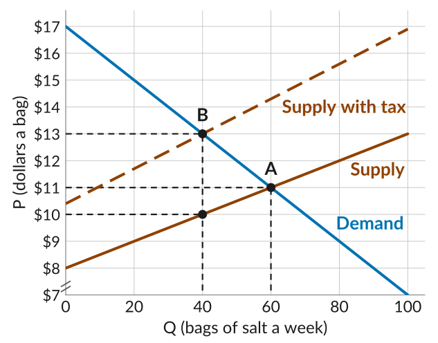
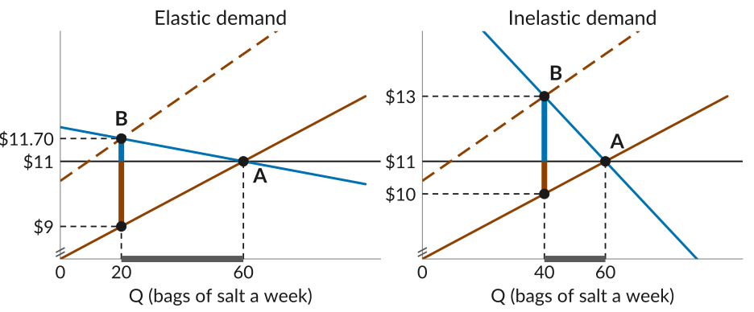
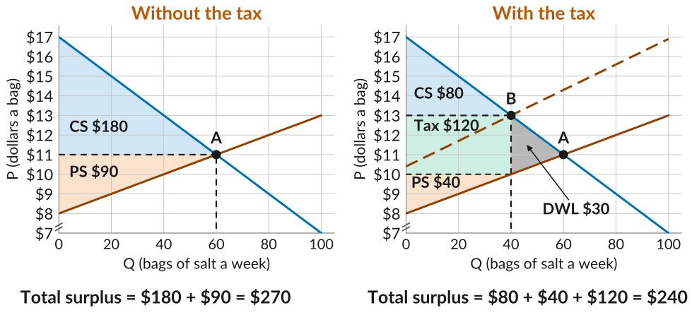
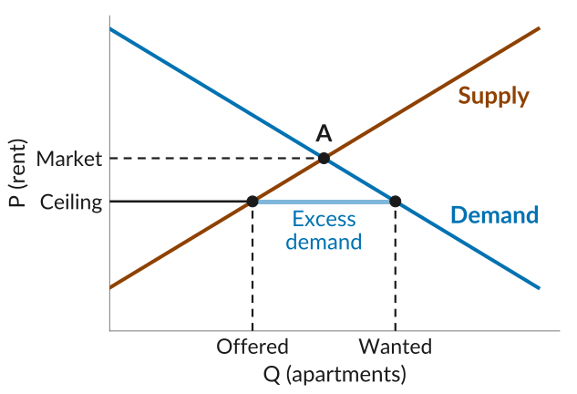
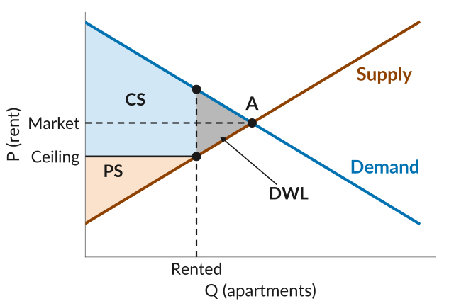
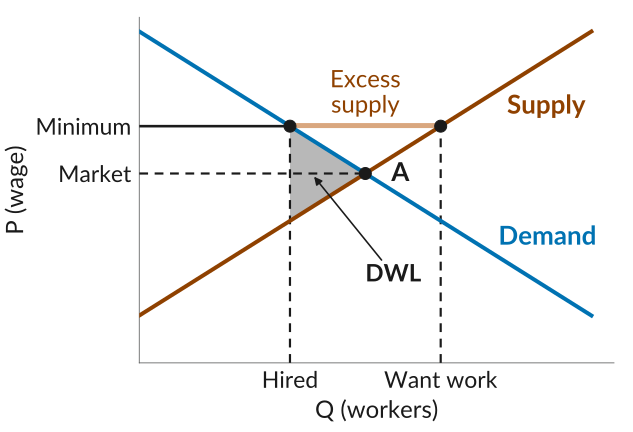

## Governments in Markets

-   Governments often intervene in markets by taxing goods or setting price controls.
-   One reason for taxes is to raise revenue to pay for public services.
-   Governments also intervene to achieve social goals. For example:
    -   Progressive taxation to reduce inequality.
    -   Rent control to make housing more affordable.
    -   Carbon taxes to reduce emissions, or cigarette taxes to reduce smoking.

::: plain
*Today*: we study these interventions using the supply and demand framework.
:::

## A Tax on Salt

-   Salt is one of the oldest goods to be taxed. As a preservative, it allowed food to be stored, transported, and traded.
-   The ancient Chinese advocated taxing salt to raise revenue because people needed it, an idea we will come back to.
-   Ruling elites in ancient India, the French monarchy, Tsarist Russia, and the British in India all taxed salt.
-   We will use a stylized salt market with a 30% sales tax.

## A 30% Salt Tax

:::::: columns
:::: {.column width="40%"}
-   Original equilibrium at A: 60 bags at \$11.
-   The tax raises sellers' marginal cost of each bag by 30\%, so the supply curve moves up and gets steeper.
-   New equilibrium at B: 40 bags at \$13.
-   *Note*: \$13 is the price buyers pay, sellers keep only \$10, and the \$3 difference goes to the city.
::::

::: {.column width="60%"}
{fig-alt="A stylized salt market, bags a week from 0 to 100 and dollars a bag from 7 to 17, with a break mark showing the price axis does not start at zero. The demand line falls from 17 dollars at zero bags. The supply line rises from 8 dollars, and a dashed line labelled Supply with tax runs 30 percent above it at every quantity. Before the tax the market clears at A, 60 bags at 11 dollars. With the tax it clears at B, 40 bags at 13 dollars, and a dot on the original supply line at 40 bags marks 10 dollars, the price sellers keep; dashed guides run to 13, 11, and 10 dollars and to 40 and 60 bags."}
:::
::::::

## Who Pays the Tax?

::: {.fixedtable}
| Outcome | Without tax | With tax |
|:--|:-:|:-:|
| Buyers pay | \$11 | \$13 |
| Sellers get | \$11 | \$10 |
| Government gets | \$0 | \$3 |
| Bags sold | 60 | 40 |

: {tbl-colwidths="[40,30,30]"}
:::

-   Buyers pay \$2 more and sellers keep \$1 less, which adds up to the \$3 tax.
-   *Tax incidence* is how a tax is shared between buyers and sellers:

$$\text{Buyers' share} = \frac{2}{3} = 67\% \quad\text{and}\quad \text{Sellers' share} = \frac{1}{3} = 33\%$$

## What Determines Who Bears the Tax?

-   *Key insight*: tax incidence, how much of the tax each side bears, does not depend on who is taxed.
    -   The sales tax is legally imposed on sellers, but that does not tell us who bears its burden.
-   Then what determines who bears the burden of the tax? The less *elastic side* of the market bears more.
    -   If buyers need salt and have few alternatives, they will buy even at a higher price, so sellers can pass on much of the tax.

## Tax Incidence and Elasticity

::: plain
The same 30% tax, with two demand curves through A.
:::

{.nostretch width="94%" fig-alt="Two panels with the same supply and taxed supply curves and the same starting point A at 60 bags and 11 dollars, with a solid line at 11 dollars across each panel. In the first, labelled Elastic demand, the demand line is fairly flat: at B, 20 bags, buyers pay 11 dollars 70, only a little above 11 dollars, and sellers keep 9 dollars, well below it, so quantity falls a lot. In the second, labelled Inelastic demand, the demand line is steeper: at B, 40 bags, buyers pay 13 dollars, well above 11 dollars, and sellers keep 10 dollars, only a little less, so quantity falls by less. In each panel a thick blue vertical segment above the 11 dollar line marks the buyers' share of the tax, a thick brown vertical segment below it marks the sellers' share, and a thick grey segment on the horizontal axis marks the fall in quantity."}

:::::: columns
::: {.column width="50%"}
Buyers: \$0.70 more. Sellers: \$2 less.
:::

::: {.column width="50%"}
Buyers: \$2 more. Sellers: \$1 less.
:::
::::::

::: plain
The less elastic side of the market bears more of the tax.
:::

## Surplus, Revenue, and Deadweight Loss

{.nostretch width="100%" fig-alt="Two panels of the salt market. In the first, labelled Without the tax, the market clears at A, 60 bags at 11 dollars; the triangle between demand and 11 dollars is shaded blue and labelled CS, 180 dollars, and the triangle between 11 dollars and supply is shaded orange and labelled PS, 90 dollars. In the second, labelled With the tax, the market clears at B, 40 bags at 13 dollars. Out to 40 bags, the triangle between demand and 13 dollars is shaded blue and labelled CS, 80 dollars; the rectangle between 10 and 13 dollars is shaded green and labelled Tax, 120 dollars; and the triangle between 10 dollars and supply is shaded orange and labelled PS, 40 dollars. The triangle between the curves from 40 to 60 bags is shaded grey and labelled DWL, 30 dollars. Below the panels, total surplus is 180 plus 90, or 270 dollars, without the tax, and 80 plus 40 plus 120, or 240 dollars, with it. The price axis starts at 7 dollars, with a break mark."}

## What Makes a Good Tax?

-   *To raise as much revenue as possible*, and reduce deadweight loss, the government would prefer to tax a good with low elasticity of demand, so that the fall in quantity is quite small.
-   But this also means that the incidence of the tax falls heavily on consumers.
-   The French monarchy's salt tax was so resented it helped bring on the French Revolution, Gandhi's 1930 salt march challenged British India's salt tax, and the 1773 Boston Tea Party protested a British tax on tea.
-   *To cut consumption* of something harmful, like tobacco or carbon, a tax works best when demand is elastic, so the quantity falls a lot.

## Price Controls

-   Another lever governments use is price controls: legal limits on a price.
-   A *price ceiling* is a maximum price, set below the market level.
    -   Examples: rent control, capped taxi fares, price gouging laws, and caps on interest rates.
-   A *price floor* is a minimum price, set above the market level.
    -   Examples: the minimum wage, farm price supports, and minimum alcohol prices.
-   In Lecture 17, we saw that a price above or below the equilibrium creates a *deadweight loss*. We can now apply that framework directly here.

## Rent Ceilings

::: plain
*Rent ceiling*: the maximum rent a landlord can legally charge, set below the market level for goals such as fairness.
:::

:::::: columns
:::: {.column width="48%"}
-   Without a ceiling, the market clears at A.
-   At the ceiling, renters want more apartments than landlords offer: an *excess demand*.
-   Trade happens on the *short side*, the side that wants to trade less: here, landlords.
::::

::: {.column width="52%"}
{fig-alt="An illustrative apartment market with no numbers. Demand falls and supply rises, meeting at A at the market rent. A solid line at a lower rent, marked Ceiling on the vertical axis, meets supply at the quantity marked Offered and demand at the larger quantity marked Wanted. The gap between them is labelled Excess demand."}
:::
::::::

## Who Gains From a Rent Ceiling?

:::::: columns
:::: {.column width="44%"}
-   Renters who get an apartment gain from the lower rent, while landlords lose: fewer apartments at a lower rent.
-   The apartments no longer rented were worth more than they cost: a *deadweight loss*.
-   The apartments may not go to those who value them most.
::::

::: {.column width="56%"}
{fig-alt="The illustrative apartment market with the rent ceiling. Out to the quantity marked Rented, the area between demand and the ceiling is shaded blue, labelled CS, and the area between the ceiling and supply is shaded orange, labelled PS. The triangle between demand and supply from the quantity rented to A is shaded grey, labelled DWL."}
:::
::::::

::: plain
*In the long run*: building more housing shifts the supply curve out, which can close the excess demand.
:::

## The Minimum Wage

:::::: columns
:::: {.column width="48%"}
-   The *minimum wage* is a price floor on labor.
-   Set above the market wage, it creates a *deadweight loss*: firms hire fewer workers, and some who want to work cannot find jobs.
-   In many real-world labor markets, it is below the market wage, so it has no effect.
-   Also, many labor markets are not perfectly competitive: employers have some market power.
::::

::: {.column width="52%"}
{fig-alt="An illustrative labor market with no numbers. Demand for workers falls and supply of workers rises, meeting at A at the market wage. A solid line at a higher wage, marked Minimum on the vertical axis, meets demand at the quantity marked Hired and supply at the larger quantity marked Want work. The gap between them is labelled Excess supply. The triangle between demand and supply from the quantity hired to A is shaded grey, labelled DWL."}
:::
::::::

## Are Taxes and Price Controls Always Costly?

-   We saw that both taxes and price controls, even when aimed at good goals, create deadweight losses.
-   If the tax revenue is spent on goods and services that improve people's wellbeing, that benefit to society may outweigh the surplus lost in the taxed market.
-   Again remember, that these losses hold only if the conditions for a competitive equilibrium to be efficient are met, and the real world is less than perfect.
-   Before Midterm 1, we saw markets that deviate from perfect competition, and after this midterm we turn to more of them. In these markets, government interventions like these can make sense again.

## Midterm 2

-   *Midterm 2 is Monday, November 9*, and covers Lectures 15 to 20.
-   The Exams page has the *Module IV notes*, the *study guide*, and two *practice exams* with solutions.
-   To prepare, read the notes, go through the study guide, do the practice problems, and finish with the practice exams, timed.
-   Bring a basic calculator. There is no help sheet.
