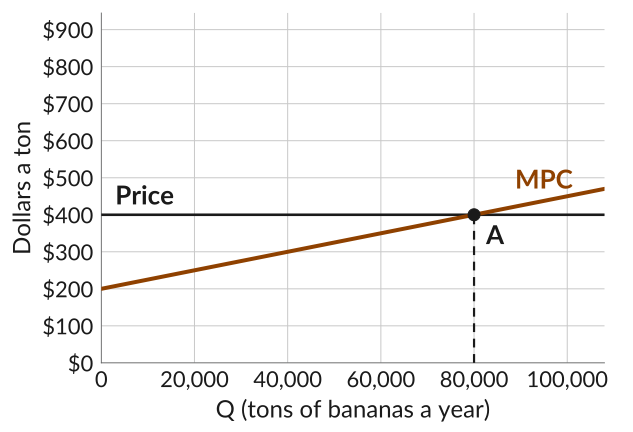
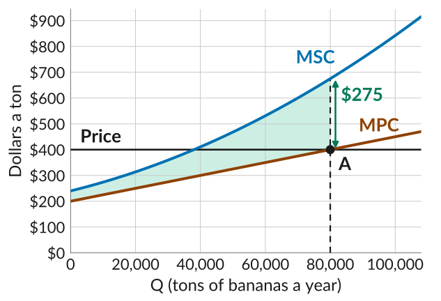
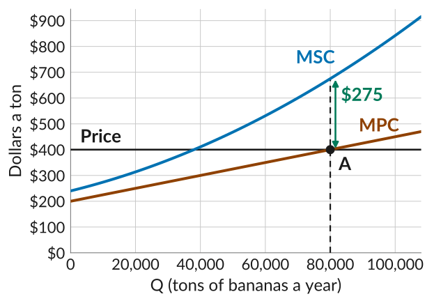
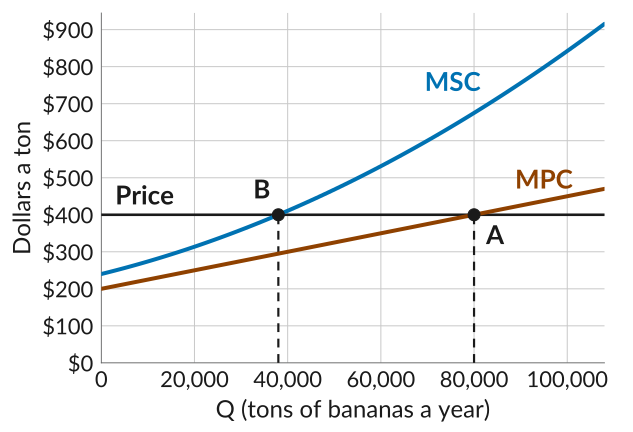
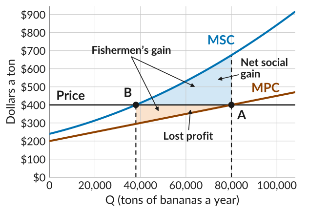
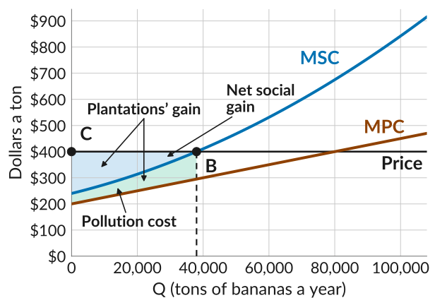

## Bananas, Fish, and Cancer

-   From 1972 to 1993, banana plantations on the French Caribbean islands of Guadeloupe and Martinique used the pesticide chlordecone.
-   It was legal, and for the plantation owners it cut costs and raised profits.
-   As the chemical washed off into rivers flowing to the coasts, fishing communities lost their livelihoods, and people eating contaminated fish fell ill.
-   The US, knowing the neurological damage it caused, had already banned it in 1976. France waited until 1990, with an exemption for the plantations until 1993.
-   In 2012, Martinique's prostate cancer rate was the world's highest, almost twice the next country's, with a death rate over four times the world average.

## Social and Private Costs and Benefits

::: plain
The devastating damage from chlordecone is an example of an *external effect* of some economic decisions.
:::

-   An *external effect* or *externality* occurs when a person's action confers a benefit or imposes a cost on others, which is not taken into account by the individual taking the action.
-   The plantation owners considered their *private* costs and benefits: the cost of the pesticide against the extra bananas and revenue. For them, it was profitable.
-   However, they ignored the *external cost* imposed on the local population in the form of lost livelihoods and ill health.
-   The *social cost*, the private and external costs added together, was much higher than the benefit of the extra bananas.

## Markets and Market Failure

-   When a market is perfectly competitive and its trades affect only the buyers and sellers, the outcome is *Pareto efficient*.
    -   No one can be better off without someone else being worse off.
    -   Remember: firms produce where $P = \text{MC}$.
-   In that case, prices send the right messages about the costs of supplying the good and the benefits of consuming it.
-   But if others are affected, prices will send the wrong messages.
    -   E.g. the price of fossil fuels leaves out the cost of global warming.
-   *Market failure* occurs when the market outcome is not Pareto efficient.
    -   Prices fail to reflect true costs or benefits, or markets are missing.

## A Banana Island

::: plain
A hypothetical island grows bananas using a pesticide that kills fish. We assume bananas cannot be grown without it. The world price is \$400 a ton.
:::

:::::: columns
:::: {.column width="46%"}
-   The island is a small seller, so it sells any amount at that price: demand is flat at $P = 400$.
-   *Marginal private cost (MPC)*: growers' cost of one more ton.
-   Growers produce every ton that sells for more than it costs them, so they stop where $P = \text{MPC}$: 80,000 tons.
::::

::: {.column width="54%"}
{fig-alt="A graph with tons of bananas a year from 0 to 100,000 on the horizontal axis and dollars a ton from 0 to 900 on the vertical axis. An upward-sloping line, labelled MPC, rises from 200 dollars at zero tons to 400 dollars at 80,000 tons and 450 dollars at 100,000. A horizontal price line, labelled Price, at 400 dollars meets the MPC line at point A, 80,000 tons, with a dashed guide down to the horizontal axis."}
:::
::::::

## The Cost to the Fishermen

:::::: columns
:::: {.column width="46%"}
-   *Marginal private cost (MPC)*: growers' cost of one more ton.
-   *Marginal external cost (MEC)*: cost one more ton imposes on the fishermen.
-   *Marginal social cost (MSC)*: full cost of one more ton, $\text{MPC} + \text{MEC}$.
::::

::: {.column width="54%"}
{fig-alt="The same graph with the MSC curve added. MPC rises in a straight line from 200 dollars at zero tons to 400 dollars at 80,000 tons, where it meets the price line at point A. MSC starts above it, at 240 dollars, and curves upward more and more steeply, crossing the price line at 38,000 tons and reaching 675 dollars at 80,000 tons. The area between the MSC curve and the MPC line from zero to 80,000 tons is shaded green. At A, a vertical double-headed arrow from the price line up to the MSC curve is labelled 275 dollars."}
:::
::::::

::: {.plain style="margin-top: 0.7em;"}
The shaded area represents the *total external cost*, the MEC of every ton added up.

Is the outcome at A Pareto efficient?
:::

## Is the Private Outcome Pareto Efficient?

:::::: columns
:::: {.column width="46%"}
-   To see whether A is Pareto efficient, imagine the plantations grew one ton less.
    -   The fishermen gain \$275, the MEC of that ton.
    -   The plantations lose hardly anything: \$400 less revenue, almost \$400 less cost.
-   So both groups could be better off with 79,999 tons, if the fishermen paid part of their \$275 gain to the plantations.
::::

::: {.column width="54%"}
{fig-alt="The graph with the MPC line, the MSC curve, and the price line at 400 dollars, meeting MPC at A, 80,000 tons. At 80,000 tons a vertical double-headed arrow runs from the price line at 400 dollars up to the MSC curve at 675 dollars, labelled 275 dollars."}
:::
::::::

::: plain
So A is not Pareto efficient.
:::

## How Much Should Production Be Reduced?

-   More generally, if output is reduced by one ton:
    -   The fishermen gain the MEC of that ton.
    -   The plantations lose the surplus they would have made from it, $P - \text{MPC}$.
-   Whenever $\text{MEC} > P - \text{MPC}$, both groups can be better off, if the fishermen share their gain by making a payment to the plantations.

$$\text{Reduce output if } P < \text{MEC} + \text{MPC} = \text{MSC}$$

-   The Pareto-efficient output is where $P = \text{MSC}$. There, the most the fishermen would pay is not enough for the plantations to cut output further.

## The Pareto-Efficient Output

:::::: columns
:::: {.column width="46%"}
-   The price is what buyers are willing to pay for a ton: the *marginal social benefit*, MSB.
-   So the Pareto-efficient output is at B, where $\text{MSB} = \text{MSC}$.
-   At B, one ton less saves the fishermen exactly what it costs the plantations, so nobody can gain without someone losing.
::::

::: {.column width="54%"}
{fig-alt="The graph with the MPC line, the MSC curve, and the price line at 400 dollars. The price line meets the MSC curve at point B, 38,000 tons, and the MPC line at point A, 80,000 tons, each with a dashed guide down to the horizontal axis."}
:::
::::::

## What If One Company Owned Both?

-   Suppose one company owned both the plantations and the fishing boats.
-   The lost fish would now be the company's own loss, so its private cost of a ton would include the harm to the fisheries.
-   It would grow 38,000 tons, the Pareto-efficient amount. The external effect is *internalized*.
-   The external effect arises because the plantations and the fisheries have different owners, and the growers do not pay for the harm they cause.

::: plain
When growers ignore the external cost, the outcome is a *market failure*: compared with the Pareto-efficient allocation, the pollutant is overused, and too many bananas are produced.
:::

## Private Bargaining

::: plain
If the fishermen paid the plantation owners to produce fewer bananas, both would be better off. Does this suggest a remedy for market failure that might be implemented in the real world?
:::

-   The economist Ronald Coase said that as long as property rights are clearly established, the two sides can negotiate a private bargain. This is *Coasean bargaining*.
-   *Property rights* are the legal protection of ownership. They can cover goods like clean water, and they can be bought and sold.
-   Coase argued that the two sides often know more about the harm than the government does, so their bargain is more likely to reach a Pareto-efficient outcome.

## Sturges v Bridgman

-   Coase used the legal case of Sturges v Bridgman to illustrate how bargaining could work.
-   Bridgman, a candy maker, had for many years been using machinery that generated noise and vibration.
-   This caused no external effects until his neighbor Sturges, a doctor, built a consulting room on the boundary of his property, close to the candy maker's kitchen.
-   The courts granted the doctor an injunction that prevented Bridgman from using his machinery.
-   The court's role was to establish the initial property rights of the two parties: in this case Bridgman's right to make noise or Sturges's right to a quiet environment.

## Coase's Argument

::: plain
Coase explained that once the court had given the property right to the doctor, the two sides could modify the outcome:
:::

-   The doctor would be willing to give up his right in return for a payment greater than the costs the noise imposed on him.
-   The candy maker would be willing to pay if his gain from using the machinery exceeded the payment.
-   So the machinery would be used only if its benefit was greater than the social cost.
-   If the court had given the property right to the candy maker instead, the doctor could have paid him to stop, with the same result.

::: plain
Either way, the result would be Pareto efficient.
:::

## If the Plantations Had the Right to Pollute

::: plain
Suppose the legal framework gives the plantations a right to pollute.
:::

:::::: columns
:::: {.column width="46%"}
-   With no bargaining, the plantations produce at A.
-   With sufficient funds, fishermen would pay them to move to B.
    -   Minimum the plantations accept: *lost profit*.
    -   Maximum the fishermen pay: *fishermen's gain*.
-   So the gap, the *net social gain*, is split by bargaining power.
::::

::: {.column width="54%"}
{fig-alt="The banana graph with the MPC line, the MSC curve, and the price line at 400 dollars, with B at 38,000 tons and A at 80,000 tons. Between 38,000 and 80,000 tons, the area below the price line and above the MPC line is shaded orange and labelled Lost profit, and the area above the price line and below the MSC curve is shaded blue and labelled Net social gain. A third label, Fishermen's gain, points to both shaded areas."}
:::
::::::

## If the Fishermen Had the Right to Clean Water

::: plain
Now suppose the legal framework gives the fishermen a right to clean water.
:::

:::::: columns
:::: {.column width="46%"}
-   With no bargaining, no bananas are grown: point C.
-   The plantations would be willing to pay to produce at B.
    -   Minimum the fishermen accept: *pollution cost*.
    -   Maximum the plantations pay: *plantations' gain*.
-   Again, the *net social gain* is split by bargaining power.
::::

::: {.column width="54%"}
{fig-alt="The banana graph with the MPC line, the MSC curve, and the price line at 400 dollars, meeting MSC at B, 38,000 tons. From zero to 38,000 tons, the area between the MPC line and the MSC curve is shaded green and labelled Pollution cost, and the area above the MSC curve and below the price line is shaded blue and labelled Net social gain. A third label, Plantations' gain, points to both shaded areas. Point C marks zero tons on the price line."}
:::
::::::

## Bargaining: Who Gets What?

::: plain
What does each side end up with after bargaining?
:::

::: {.fixedtable .wide .grouptable}
| Plantations | Fishermen | Payment |
|:--|:--|:--|
| *Case 1: right to pollute* (no bargaining: A, 80,000 tons) |  |  |
| Profit on 38K tons, plus the payment | Pollution cost of 38K tons, and they pay | At least the lost profit, at most the fishermen's gain |
| *Case 2: right to clean water* (no bargaining: C, no bananas) |  |  |
| Profit on 38K tons, minus the payment | Pollution cost of 38K tons, and they are paid | At least the pollution cost, at most the plantations' gain |

: {tbl-colwidths="[30,33,37]"}
:::

-   Both cases end at 38,000 tons, and both sides gain from the bargain.
-   The right decides who pays whom. Bargaining power decides how much.

## Efficiency and Equity

-   *Efficiency*: bargaining reaches the Pareto-efficient output whoever holds the initial rights. It is 38,000 tons in both cases.
-   *Equity*: bargaining power decides how the net social gain is split. But the initial allocation of property rights is also very important for determining the distribution of incomes, because it sets what each side has with no bargaining.
    -   *Case 1*, a right to pollute: the fishermen start with pollution, still suffer from it at B, and have to pay to stop it getting worse.
    -   *Case 2*, a right to clean water: they start with no pollution and are paid to allow some, a far better outcome.

## Coase's Idea in Practice

::: plain
Coase's idea: establish clear property rights, then let them be bought and sold.
:::

-   *Clean water*: in the 1990s, New York City agreed to pay upstate farmers and towns to keep pollution out of its reservoirs, instead of building a filtration plant.
-   *Pollution permits*: in the 1990s, the US capped sulfur dioxide from power plants and gave them permits they could trade. California has done the same for carbon since 2013.
-   *Radio spectrum*: Coase proposed in 1959 that the right to use each frequency be sold. The US has auctioned spectrum licenses since 1994.
-   *Fishing quotas*: New Zealand limits the total catch and gives fishers shares of it that they can sell.

## When Bargaining Fails

::: plain
*Transaction costs* are the costs of reaching and enforcing a bargain.
:::

-   *Unclear property rights*: for years only DuPont knew how its chemical PFOA harmed local water, so there were no rights to bargain over.
-   *Impediments to collective action*: there may be many parties on each side, all affected in different ways.
-   *Missing or asymmetric information*: the costs and benefits of everyone involved have to be measured.
-   *Tradability and enforcement*: the bargain trades property rights, and the contract must be enforceable.
-   *Limited funds*: the buyer of a property right must be able to pay for it.

::: plain
*Next class*: other solutions.
:::
