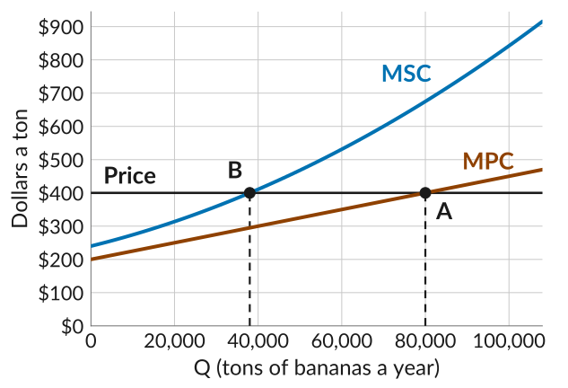
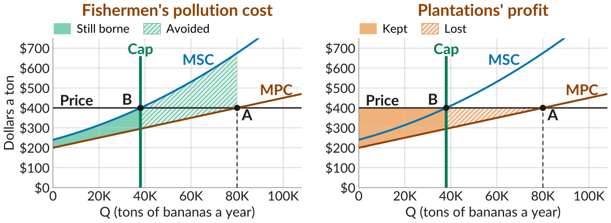
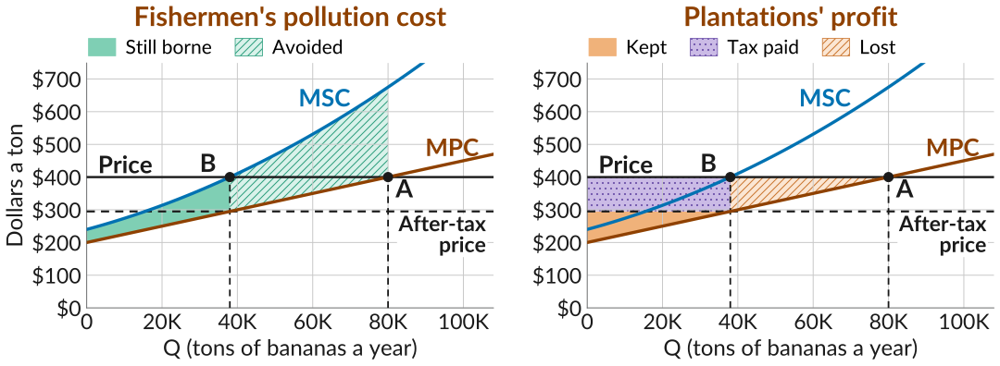
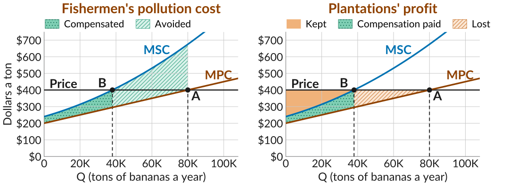

## Too Many Bananas

::: plain
Last class: banana plantations use a pesticide that kills fish in the sea.
:::

:::::: columns
:::: {.column width="46%"}
-   *The problem*: the plantations weigh their private cost, not the cost to everybody.
-   Counting only their *private* cost (MPC), they grow 80,000 tons at \$400: point A.
-   Counting the *social* cost (MSC), the optimal amount is less: 38,000 tons, point B.
::::

::: {.column width="54%"}
{fig-alt="A graph with tons of bananas a year from 0 to 100,000 on the horizontal axis and dollars a ton from 0 to 900 on the vertical axis. The MPC line rises from 200 dollars at zero tons to 400 dollars at 80,000 tons. The MSC curve starts above it, at 240 dollars, and bends upward, reaching 400 dollars at 38,000 tons and 675 dollars at 80,000. A horizontal price line, labelled Price, at 400 dollars meets the MSC curve at point B, 38,000 tons, and the MPC line at point A, 80,000 tons, each with a dashed guide down to the horizontal axis."}
:::
::::::

::: plain
*How to get from A to B?*
:::

## Solution 1: Coasean Bargaining

-   The economist Ronald Coase's idea: give the *property right* to one side, then let the two sides bargain.
    -   Right to clean water: plantations pay fishermen to use the pesticide.
    -   Right to pollute: fishermen pay plantations to cut back.
-   Who holds the right decides who pays, and who ends up better off.
-   But in both cases, bargaining reaches the socially optimal output.
-   *Real world*: since the 1990s, New York City has paid upstate farms to control their pollution and keep its reservoirs clean, instead of building a filtration plant costing billions.
-   *Challenge*: many parties, missing information, limited funds.

## Today: Three More Solutions

::: plain
When bargaining is not practical, the government can step in:
:::

-   *Solution 2*: regulation, such as a cap on the quantity produced.
-   *Solution 3*: taxation of the activity that causes the harm.
-   *Solution 4*: compensation of those who are harmed.

::: plain
We continue to assume that bananas cannot be produced without the pesticide.
:::

## Solution 2: Regulation (a Cap on Output)

::: plain
*Regulation*: the government caps output at 38,000 tons, point B.
:::

::: {.gap}
:::

{.nostretch width="100%" fig-alt="Two graphs side by side, each with the MPC line, the MSC curve and the price line at 400 dollars, with B at 38,000 tons and A at 80,000 tons. A vertical line at 38,000 tons is labelled Cap. Left, the fishermen's pollution cost, the area between the MSC curve and the MPC line: the part from zero to 38,000 tons is solid and keyed as Still borne, and the part from 38,000 to 80,000 tons is hatched and keyed as Avoided. Right, the plantations' profit, the area below the price line and above the MPC line: the part from zero to 38,000 tons is solid and keyed as Kept, and the part from 38,000 to 80,000 tons is hatched and keyed as Lost."}

## Regulation: Summary

::: plain
With a cap on output at 38,000 tons:
:::

-   *What happens*: output falls from A to B, 38,000 tons.
    -   Fishermen: pollution cost falls.
    -   Plantations: lose the profit on the tons no longer grown.
    -   Government: gets nothing.
-   *Real world*: John Wayne Airport caps its passengers each year to limit noise for its neighbors, and US fisheries have annual catch limits.
-   *Challenge*: the right quota for each firm is hard to determine and enforce when firms differ in size and output.

## Solution 3: A Pigouvian Tax

::: plain
At B, the MEC is $400 - 295 = \$105$. A \$105 tax leaves plantations \$295 a ton, so they stop at B: a *Pigouvian tax*, after Arthur Pigou.
:::

::: {.gap}
:::

{.nostretch width="100%" fig-alt="Two graphs side by side, each with the MPC line, the MSC curve and the price line at 400 dollars, with B at 38,000 tons and A at 80,000 tons. A dashed horizontal line at 295 dollars is labelled After-tax price and meets the MPC line at 38,000 tons. Left, the fishermen's pollution cost, the area between the MSC curve and the MPC line: the part from zero to 38,000 tons is solid and keyed as Still borne, and the part from 38,000 to 80,000 tons is hatched and keyed as Avoided. Right, the plantations' profit: from zero to 38,000 tons, the area between the MPC line and the after-tax price is solid and keyed as Kept, and the rectangle between 295 and 400 dollars is dotted and keyed as Paid as tax. From 38,000 to 80,000 tons, the area below the price line and above the MPC line is hatched and keyed as Lost."}

## Pigouvian Tax: Summary

::: plain
With a tax of \$105 on each ton:
:::

-   *What happens*: output falls from A to B, 38,000 tons.
    -   Fishermen: pollution cost falls, as with the cap.
    -   Plantations: lose that profit, and pay the tax on every ton they still grow.
    -   Government: gets the tax revenue.
-   *Real world*: Sweden's carbon tax, since 1991, and New York City's \$9 congestion toll.
-   *Challenge*: the government must know the marginal external cost at the efficient output.

## Solution 4: Compensation

::: plain
Plantations must pay fishermen the MEC of each ton. Their cost becomes $\text{MPC} + \text{MEC} = \text{MSC}$, so they stop at B.
:::

::: {.gap}
:::

{.nostretch width="100%" fig-alt="Two graphs side by side, each with the MPC line, the MSC curve and the price line at 400 dollars, with B at 38,000 tons and A at 80,000 tons. Left, the fishermen's pollution cost, the area between the MSC curve and the MPC line: the part from zero to 38,000 tons is dotted and keyed as Compensated, and the part from 38,000 to 80,000 tons is hatched and keyed as Avoided. Right, the plantations' profit: from zero to 38,000 tons, the area between the MSC curve and the price line is solid and keyed as Kept, and the area between the MPC line and the MSC curve is dotted, the same area as on the left, and keyed as Paid as compensation. From 38,000 to 80,000 tons, the area below the price line and above the MPC line is hatched and keyed as Lost."}

## Compensation: Summary

::: plain
When plantations must pay for the harm from each ton:
:::

-   *What happens*: output falls from A to B, 38,000 tons.
    -   Fishermen: pollution cost falls, and they are paid for the harm that remains.
    -   Plantations: lose that profit, and pay the compensation.
    -   Government: gets nothing.
-   *Real world*: usually liability law. A firm that causes harm must pay for it, like BP after the 2010 Gulf oil spill. Knowing this, firms take more care.
-   *Challenge*: the harm from every unit must be measured, and the payment enforced.

## Government Solutions: Who Gets What?

::: plain
What does each side end up with under each solution?
:::

::: {.fixedtable .wide .gridtable .fullsize}
| Policy | Plantations | Fishermen | Government |
|:--|:--|:--|:--|
| Regulation (cap) | Profit on 38K tons | Pollution cost of 38K tons | Nothing |
| Pigouvian tax | Profit on 38K tons, minus the tax paid | Pollution cost of 38K tons | Tax of \$105 on each of 38K tons |
| Compensation | Profit on 38K tons, minus the compensation paid | Pollution cost of 38K tons, fully paid back | Nothing |

: {tbl-colwidths="[20,28,27,25]"}
:::

::: plain
In all three the polluter pays, so none is a Pareto improvement on A.
:::

## Limits of Government Solutions

::: plain
All three solutions run into the same limits:
:::

-   Marginal social costs are difficult to measure, just as in Coasean bargaining.
-   So it is difficult for the government to find the Pareto-efficient outcome, or to distribute compensation fairly.
-   Governments may favor the more powerful group: an outcome that is Pareto efficient but unfair.

## Back to Chlordecone: Diagnosis and Treatment

::: plain
Back to Guadeloupe and Martinique: would our solutions have worked?
:::

-   *Diagnosis*: in our model, too many bananas. In reality, the pesticide: there were other ways to grow bananas.
    -   Its low price said "Use this chemical". A price with the full external cost would have said "Find an alternative".
-   *Treatment*: a cap or a tax on bananas gives no reason to switch.
    -   Better: tax or regulate chlordecone itself, or require compensation.
    -   It did so much harm that it should not have been used at all: bananas grown with it cost society more than their price.
-   *In general*: it is better to tax or cap what causes the harm than the output, especially when the output can be made without it.

## Negative and Positive Externalities

::: plain
The problem of external effects arises in many different settings.
:::

-   *Negative externality* (external cost): a cost inflicted on others without compensating payment.
    -   Private cost is below social cost, so too much is produced or consumed. E.g. pollution.
-   *Positive externality* (external benefit): an uncompensated benefit conferred on others.
    -   Private benefit is below social benefit, so too little is done. E.g. a vaccination.
-   Externalities arise in both production and consumption.

## Negative Externalities Everywhere

:::::: columns
:::: {.column width="50%" style="align-self: flex-start;"}
*From production*:

-   Noise near airports.
-   Unsafe factories.
-   Deforestation.
-   Carbon emissions.
::::

:::: {.column width="50%" style="align-self: flex-start;"}
*From consumption*:

-   Overuse of antibiotics.
-   Smoking.
-   Driving to work.
-   Noisy students late at night.
-   Plastic bags.
::::
::::::

## Positive Externalities and Their Remedies

::: plain
External benefits cause misallocation too: nobody pays the decision-maker for the benefit to others, so too little is done.
:::

-   *Examples*: a vaccination protects the people you would have infected. A firm's R&D is used by other firms. A worker it trains can leave for another employer.
-   The same solutions apply, in reverse:
    -   *Regulation*: a requirement instead of a cap, like the vaccines required to attend school.
    -   *Pigouvian subsidy*: a payment instead of a tax, for example for worker training.
    -   *Property rights*: patents and copyrights let inventors and authors earn from their work, but they limit competition.

## Remedies in the Real World: A Summary

-   *Legal liability*: the law makes people pay for harm they cause, like a carmaker for a design fault. But congestion and air pollution are not covered.
-   *Regulation*: bans (chlordecone, lead in gasoline) and limits (noise hours for venues). A blunt instrument.
-   *Tradable permits*: a limit on total pollution, with permits that firms can trade. This creates a market for the right to pollute.
-   *Taxes*: raise the price to reflect the social cost, like taxes on plastic bags and landfill.

::: plain
What works depends on how many people are affected, how easy the effects are to measure, and how to ensure compliance.
:::

## What to Do Next

-   *Quiz 8 is Monday, November 30*, and covers Lectures 21 and 22.
-   To prepare, go over the *slides*, textbook readings (sections *10.1* to *10.5*), and *practice problems* for both lectures.
